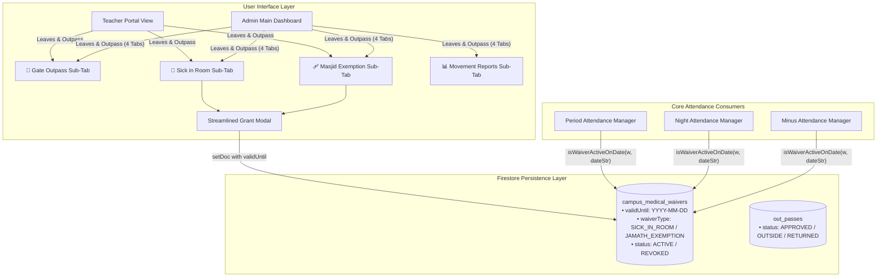

# Streamlined Leave Granting & Unified Admin Leaves Hub

*   **Author:** safmuzammil
*   **Status:** Draft
*   **Date:** 2026-11-11

--------------------------------------------------------------------------------

## Overview

This technical design outlines the streamlining of the campus medical waiver modal forms and the restructuring of the Administrator leave management desk within the Darul Huda Degree Campus ERP.

The current waiver grant interface demands five distinct inputs, including location and freeform notes that are unnecessary for campus operations, while relegating custom diagnoses below a lengthy preset list. Additionally, the Admin Portal exposes gate passes under an isolated `Out-Pass Portal` view without surfacing the internal `Sick in Room` and `Masjid Exemption` sub-tabs available to teachers.

This design introduces a rapid 3-step modal (Student Search, Custom-First Reason with 1-tap template chips, and Validity End Date defaulting to end-of-day expiration) and unifies the Admin navigation into a 4-tab `Leaves & Outpass` desk with campus-wide search and issuance privileges.

## The Problem

1. **Mobile Input Overhead for Faculty**: When recording bed rest for acute ailments or issuing stair-climbing exemptions, teachers currently face five form fields on mobile viewports. Fields such as "Hostel Room / Location" and "Additional Notes" add needless typing and screen clutter since campus wardens do not conduct in-room dispensary rounds.
2. **Preset Inflexibility**: Custom diagnoses are currently forced into a secondary input below a rigid dropdown list, creating cognitive friction when a student presents with an unlisted condition.
3. **Absence of Expiration Timing**: Current waivers persist indefinitely until a faculty member remembers to manually click "Mark Recovered". This leads to stale waivers lingering across days, artificially suppressing attendance counts.
4. **Admin Portal Fragmentation**: Administrators currently see only gate outpass logs under `Out-Pass Portal` (`🪪`). To view internal sick bed rests or prayer exemptions, admins have to navigate external interfaces rather than managing all three institutional leave categories in a centralized hub.

## Goals

*   **Sub-5-Second Mobile Leave Issuance**: Reduce the leave granting modal to strictly three intuitive steps: predictive student picker, reason selection, and validity duration.
*   **Custom-First Reason Architecture**: Position `✍️ Custom Reason...` as option 0 with autofocus text entry, accompanied by 1-tap template preset chips (`Fever / Flu`, `Stomach Ache`, `Sprain / Bruise`) that immediately populate the field.
*   **Automated Date Expiration**: Default all new bed-rest waivers to expire at midnight of the current date (`23:59:59`), with quick duration chips (`Today Only`, `+1 Day`, `+2 Days`, `Custom Date`) for multi-day excusals.
*   **Unified Admin Leaves Desk**: Elevate Admin Portal navigation to `Leaves & Outpass` (`🪪`), presenting a persistent 4-tab interface:
    1. `🪪 Gate Outpass`
    2. `🤒 Sick in Room`
    3. `🩹 Masjid Jamath Exemption`
    4. `📊 Movement & Audit Reports`
*   **Backward Compatibility Invariant**: Preserve existing production waivers without a `validUntil` field as active until manually revoked, preventing premature mass-expiration.

## Non-Goals

*   **Hostel Room Tracking**: Tracking student bed or wing occupancy is explicitly out of scope because wardens do not perform hostel room inspections.
*   **Pharmacy & Medication Tracking**: Managing medical inventory, prescriptions, or dispensary doctor logs.
*   **Multi-Step Approval Workflows**: Requiring multiple sign-offs (e.g., student request → warden approval → principal signature). Waivers remain directly authorizable by Class Teachers and Administrators.

## Open Questions

*   None. All architectural and operational requirements were confirmed during the multi-lens brainstorm.

## Critical User Journeys (CUJs)

### CUJ 1: Class Teacher Grants Same-Day Bed Rest on Mobile
*   **Given**: A teacher is taking morning period attendance or receiving a student message regarding acute fever.
*   **When**: The teacher opens `Leaves & Outpass` → `Sick in Room`, searches for the student (`Salman` or `#3456`), taps `[🤒 Fever / Flu]` chip, and taps `[Confirm & Grant Bed Rest]`.
*   **Then**: The waiver is saved with `validUntil` set to today's date. Periods 1–9 automatically display `🤒 Sick in Room` in Amber without academic penalty. At midnight tonight, the waiver naturally lapses, requiring zero manual cleanup next morning.

### CUJ 2: Class Teacher Issues Multi-Day Sprain Exemption
*   **Given**: A student has suffered a foot injury requiring a 3-day recovery.
*   **When**: The teacher selects the student in `Masjid Jamath Exemption`, taps `[+2 Days (Day After)]` chip, enters `Right foot sprain, bandage applied`, and confirms.
*   **Then**: The waiver persists across today and the next two days, protecting the student in `MinusAttendanceManager` from "Jamath Missing" deductions. On the fourth day, the waiver ceases excusal automatically.

### CUJ 3: Administrator Manages All Campus Leaves
*   **Given**: The administrator logs into the main ERP dashboard.
*   **When**: The admin taps `Leaves & Outpass` in the navigation drawer.
*   **Then**: The admin sees four sibling tabs: `Gate Outpass`, `Sick in Room`, `Masjid Exemption`, and `Movement Reports`. The admin can search any student across all classes to inspect or grant bed rest or Jamath exemptions.


--------------------------------------------------------------------------------

## Technical Plan (Architecture)

### 1. Architectural System Topology



### 2. Streamlined Leave Modal Architecture

The modal UI in both `SickInRoomSubTab.jsx` and `MasjidExemptionSubTab.jsx` is re-engineered from a multi-field questionnaire into an agile 3-tier action card:

1. **Section 1: Verified Student Picker**:
   * Reactive text input matching student first name, admission number (`#adNo`), or class.
   * Selecting a candidate renders a compact verified banner with photo avatar, roll number, and an instant `[✕ Change]` action.
2. **Section 2: Custom-First Reason with 1-Tap Template Chips**:
   * Dropdown selector with `✍️ Custom Reason...` fixed at index 0.
   * When `✍️ Custom Reason...` is active, a single-line input field appears with placeholder `e.g. Severe throat infection...`.
   * Directly below the input sits a horizontal flex-wrap palette of 1-tap template chips:
     * *Sick in Room*: `[🤒 Fever / Flu]`, `[🤢 Stomach Ache]`, `[🤕 Headache / Migraine]`, `[🤮 Vomiting / Nausea]`, `[🤧 Cold / Cough]`.
     * *Masjid Exemption*: `[🩹 Leg Fracture / Cast]`, `[🩼 Crutches / Sprain]`, `[🩸 Open Wound / Dressing]`, `[🦶 Ankle Bruise]`.
   * Tapping any chip immediately sets the reason text and commits the selection without scrolling.
3. **Section 3: Validity End Date (`validUntil`)**:
   * Quick duration buttons:
     - `[Today Only]` (Sets `validUntil = todayStr`) — selected by default.
     - `[+1 Day (Tomorrow)]` (Sets `validUntil = todayStr + 1 day`).
     - `[+2 Days (Day After)]` (Sets `validUntil = todayStr + 2 days`).
     - `[Custom Date]` (Reveals native `<input type="date">` for longer recoveries).
   * Live visual status echo:
     `<div style="color: #047857; background: #ecfdf5; padding: 6px 10px; borderRadius: 6px;">`
     `⏳ Excuses student through {formattedDate} (Auto-expires at Midnight)`
     `</div>`
4. **Eliminated Fields**:
   * `roomNumber` and `notes` are completely purged from both JSX and Firestore document payload.

### 3. Expiration Engine & Attendance Engine Sync

All attendance consumers synchronize against an authoritative helper function:

```javascript
/**
 * Evaluates whether a campus medical waiver is active on a specific operational date.
 * 
 * @param {Object} waiver - The document from campus_medical_waivers
 * @param {string} targetDate - The attendance session date (YYYY-MM-DD)
 * @returns {boolean} True if the waiver excuses the student on targetDate
 */
export const isWaiverActiveOnDate = (waiver, targetDate) => {
  if (!waiver || waiver.status !== 'ACTIVE') return false;
  
  // Backward compatibility: legacy waivers without validUntil remain open-ended
  // until explicitly marked recovered:
  if (!waiver.validUntil) return true;
  
  return targetDate <= waiver.validUntil;
};
```

#### Consumer Implementations:
* **Period Attendance (`PeriodAttendanceManager.jsx`)**:
  Maps active waivers where `isWaiverActiveOnDate(w, selectedDate)` into `allRecs` with:
  ```javascript
  {
    startDate: w.issuedAt ? w.issuedAt.split('T')[0] : selectedDate,
    endDate: w.validUntil || selectedDate,
    hasDuration: Boolean(w.validUntil && w.validUntil !== selectedDate),
    reason: w.injuryReason,
    isMedical: true,
    isSickRoom: true,
    permittedBy: w.issuedByName || 'Class Teacher'
  }
  ```
* **Night Attendance (`NightAttendanceManager.jsx`)**:
  When evaluating pre-saved status or calculating the nightly absentee roster:
  Filters `activeCampusWaiversMap` against `isWaiverActiveOnDate(w, selectedDate)`. Lapsed waivers do not mark students `SICK_ROOM`.
* **Minus Attendance (`MinusAttendanceManager.jsx`)**:
  Cross-checks `activeJamathExemptions` against `isWaiverActiveOnDate(w, selectedDate)` before evaluating missing Jamath deductions.

### 4. Admin Portal 4-Tab Desk Architecture

In `app/page.jsx`, the navigation drawer entry is updated:
```javascript
{ id: 'outpass', label: 'Leaves & Outpass', icon: '🪪', desc: 'Live campus movement & medical waivers' }
```

In `app/outpass/page.jsx`, when `isAdminProp === true` or user has Admin privileges:
* The previous role selector tab (`activeTab === "admin"`) is elevated into a persistent horizontal segmented bar:
  1. `[🪪 Gate Outpass]` (`activeTab = "outpass"`) — Includes real-time off-campus counters, gate pass issuance, and security barcode logs.
  2. `[🤒 Sick in Room]` (`activeTab = "sick_room"`) — Direct embedding of `SickInRoomSubTab` with `isAdmin={true}` (unrestricted all-campus student search).
  3. `[🩹 Masjid Jamath Exemption]` (`activeTab = "masjid_exempt"`) — Direct embedding of `MasjidExemptionSubTab` with `isAdmin={true}` (unrestricted all-campus search).
  4. `[📊 Movement Reports]` (`activeTab = "admin_reports"`) — Direct access to the 14 institutional movement and compliance analytics reports.
* Top toolbar actions preserve access to `⚙️ Settings` (student ID photo uploads & schedule locks) and `🛡️ Security Kiosk`.


--------------------------------------------------------------------------------

## Alternatives Considered

### Alternative 1: Retaining Hostel Room Tracking & Silent Data Enrichment
*   **Description**: Keeping a hostel room input or silently injecting the student's registered hostel room from their profile into the waiver document behind the scenes.
*   **Pros**: Preserves hostel wing location in case outside emergency personnel require room location.
*   **Cons**: Introduces unnecessary database fields and code complexity for a feature that is unused operationally.
*   **Reason for Rejection**: *Rejected by author*: Campus wardens do not conduct in-room bed inspections or dispensary visits in this institution. Room tracking has zero operational utility and creates needless cognitive and data overhead.

### Alternative 2: Scheduled Midnight Cron/Batch Job to Mutate Document Status to 'EXPIRED'
*   **Description**: Running a nightly Firebase Cloud Function or automated client batch at midnight to query active waivers and write `status = 'EXPIRED'` to Firestore.
*   **Pros**: Allows simple query filtering with `where("status", "==", "ACTIVE")` without evaluating date math in client components.
*   **Cons**: Adds cloud infrastructure dependencies, potential billing/quota overhead, and introduces race conditions if the cron fails or delays.
*   **Reason for Rejection**: *Rejected by author*: Evaluating expiration dynamically in client memory (`targetDate <= validUntil`) is instantaneous, offline-compatible, requires zero background workers, and eliminates database write costs.

### Alternative 3: Sub-Modal Dialog for Custom Diagnoses
*   **Description**: Keeping preset ailment buttons and opening a secondary popup modal when the user taps "Custom Reason".
*   **Pros**: Keeps the primary modal small until custom input is needed.
*   **Cons**: Stacking nested modals on mobile viewports causes iOS/Android keyboard dismissal bugs, scroll locks, and visual disorientation.
*   **Reason for Rejection**: *Rejected by author*: Placing `✍️ Custom Reason...` directly at index 0 of the dropdown and revealing an inline text box provides immediate access without modal-in-modal nesting.

### Alternative 4: Hiding Sick in Room & Masjid Exemption Inside Admin Reports
*   **Description**: Leaving the Admin navigation as `Out-Pass Portal` and adding tabs for bed rest inside the existing 14-report audit table.
*   **Pros**: Avoids altering the top-level navigation layout.
*   **Cons**: Degrades internal waivers into read-only audit logs. Administrators would be unable to quickly grant, extend, or revoke leaves across campus classes.
*   **Reason for Rejection**: *Rejected by author*: The Admin Portal must provide full operational parity with the Teacher Portal, allowing administrators to search and grant waivers across all classes from a unified 4-tab desk.

--------------------------------------------------------------------------------

## Non-Functional Requirements

### 1. Performance & Latency
*   **Instant Client-Side Filtering**: Expiration checks run synchronously in local state without issuing additional network roundtrips to Firestore.
*   **Mobile Touch Ergonomics**: All quick-duration chips and template buttons maintain a minimum 44×44px tap area to support rapid single-handed operation on mobile devices.

### 2. Backward Compatibility & Zero-Downtime Rollout
*   **Legacy Record Preservation**: Existing documents in `campus_medical_waivers` lacking a `validUntil` attribute are treated as open-ended active waivers, ensuring no active student excusal is prematurely stripped during deployment.
*   **Schema Safety**: The addition of `validUntil` is strictly additive and fully conforms to existing `firestore.rules` validators.


--------------------------------------------------------------------------------

## Detailed Implementation Plan

### Target Files to Create/Modify

#### 1. [`app/outpass/components/SickInRoomSubTab.jsx`](file:///D:/Codes/mark-entry-app/app/outpass/components/SickInRoomSubTab.jsx) (Modify)
*   **Type / Scope**: React Component (Bed Rest Sub-Tab)
*   **Proposed Changes**:
    *   **Purge Clutter Fields**: Remove `roomNumber` and `notes` state hooks, labels, inputs, and payload bindings.
    *   **Custom-First Reason Combobox**:
        *   Restructure `ILLNESS_PRESETS` to place `'CUSTOM'` (`"✍️ Custom Diagnosis / Reason..."`) at index 0.
        *   When `'CUSTOM'` is active, render an autofocus single-line input field.
        *   Render a horizontal flex-wrap palette of 1-tap template chips (`[🤒 Fever / Flu]`, `[🤢 Stomach Ache]`, `[🤕 Headache / Migraine]`, `[🤮 Vomiting / Nausea]`, `[🤧 Cold / Cough]`). Tapping any chip immediately sets the custom input text and syncs the selection.
    *   **Validity Duration Selector**:
        *   Add `durationPreset` state (`'TODAY'` | `'1_DAY'` | `'2_DAYS'` | `'CUSTOM'`) defaulting to `'TODAY'`.
        *   Add `validUntil` date state defaulting to `new Date().toISOString().split('T')[0]`.
        *   Provide 1-tap duration buttons: `[Today Only]`, `[+1 Day (Tomorrow)]`, `[+2 Days (Day After)]`, `[Custom Date]`.
        *   Render a live visual confirmation pill: `⏳ Excuses student through {validUntil} (Auto-expires at Midnight)`.
    *   **Payload & Filtering**:
        *   Save `validUntil` into Firestore document payload (`status: 'ACTIVE'`).
        *   Update active list filter to use `isWaiverActiveOnDate(w, todayStr)`. Lapsed waivers display in the Historical / Revoked section as `Expired`.

#### 2. [`app/outpass/components/MasjidExemptionSubTab.jsx`](file:///D:/Codes/mark-entry-app/app/outpass/components/MasjidExemptionSubTab.jsx) (Modify)
*   **Type / Scope**: React Component (Masjid Jamath Exemption Sub-Tab)
*   **Proposed Changes**:
    *   **Purge Clutter Fields**: Remove `notes` textarea and payload binding.
    *   **Custom-First Reason Combobox**:
        *   Place `'CUSTOM'` (`"✍️ Custom Condition / Description..."`) at index 0 of `INJURY_PRESETS`.
        *   Render 1-tap template chips (`[🩹 Leg Fracture / Cast]`, `[🩼 Crutches / Sprain]`, `[🩸 Open Wound / Dressing]`, `[🦶 Ankle Bruise]`) below the input.
    *   **Validity Duration Selector**:
        *   Implement identical `validUntil` date selector and 1-tap duration chips defaulting to `'TODAY'`.
    *   **Payload & Filtering**:
        *   Save `validUntil` into Firestore document payload.
        *   Update active list filter to use `isWaiverActiveOnDate(w, todayStr)`.

#### 3. [`app/page.jsx`](file:///D:/Codes/mark-entry-app/app/page.jsx) (Modify)
*   **Type / Scope**: Main Navigation & Layout Container
*   **Proposed Changes**:
    *   Update navigation drawer items and desktop tab descriptors:
        *   Change `label: 'Out-Pass Portal'` to `label: 'Leaves & Outpass'`.
        *   Update description to `'Live campus movement & medical waivers'`.

#### 4. [`app/outpass/page.jsx`](file:///D:/Codes/mark-entry-app/app/outpass/page.jsx) (Modify)
*   **Type / Scope**: Unified Leaves & Outpass Routing Desk
*   **Proposed Changes**:
    *   Elevate Admin navigation hierarchy:
        *   When `isAdminProp === true` or user is Admin, render the persistent 4-tab segmented navigation bar:
            1. `[🪪 Gate Outpass]`
            2. `[🤒 Sick in Room]`
            3. `[🩹 Masjid Jamath Exemption]`
            4. `[📊 Movement Reports]`
        *   Embed `SickInRoomSubTab` and `MasjidExemptionSubTab` directly with `isAdmin={true}` to enable unrestricted campus-wide student search and granting.
        *   Keep secondary Admin utilities (`⚙️ Settings` for student photo uploads/schedule locks and `🛡️ Security Kiosk`) accessible in the top-right toolbar.

#### 5. [`app/components/PeriodAttendanceManager.jsx`](file:///D:/Codes/mark-entry-app/app/components/PeriodAttendanceManager.jsx) (Modify)
*   **Type / Scope**: Period Attendance Engine
*   **Proposed Changes**:
    *   Filter active `campus_medical_waivers` using `isWaiverActiveOnDate(w, selectedDate)`.
    *   Explicitly map `startDate: w.issuedAt ? w.issuedAt.split('T')[0] : selectedDate` and `endDate: w.validUntil || selectedDate`.
    *   Pass `hasDuration: Boolean(w.validUntil && w.validUntil !== selectedDate)` so period attendance multi-day date range comparisons function accurately.

#### 6. [`app/components/NightAttendanceManager.jsx`](file:///D:/Codes/mark-entry-app/app/components/NightAttendanceManager.jsx) (Modify)
*   **Type / Scope**: Night Roll-Call Manager
*   **Proposed Changes**:
    *   In the real-time listener and nightly absentee calculation, evaluate `isWaiverActiveOnDate(w, selectedDate)` for every document in `activeCampusWaiversMap`.
    *   Ensure waivers that have passed their `validUntil` date do not trigger `SICK_ROOM` status in night attendance.

#### 7. [`firestore.rules`](file:///D:/Codes/mark-entry-app/firestore.rules) (Modify)
*   **Type / Scope**: Security Rules & Schema Validator
*   **Proposed Changes**:
    *   Update `isValidMedicalWaiver(data)` domain validator to permit the optional `validUntil` field:
        `(!('validUntil' in data) || data.validUntil == null || (data.validUntil is string && data.validUntil.size() <= 20))`

---

### Verification Plan

*   **Compilation & Build**:
    *   Run `npm run build` with Turbopack outside sandbox to ensure zero JSX syntax, import, or prop type errors.
*   **Modal Form Verification**:
    *   Verify modal renders on mobile viewports (<640px) without scrolling or hidden submit buttons.
    *   Test tapping template chips (`[🤒 Fever / Flu]`) immediately sets the custom input.
    *   Test duration chips (`[Today Only]`, `[+1 Day]`, `[+2 Days]`, `[Custom Date]`) accurately calculate and display the live preview pill.
*   **Expiration Verification**:
    *   Grant a test waiver with `validUntil = today`. Confirm it appears active on today's date.
    *   Verify that navigating to tomorrow's date treats the waiver as expired in Period, Night, and Minus Attendance.
    *   Verify that legacy waivers without `validUntil` remain active.
*   **Admin Portal 4-Tab Verification**:
    *   Log in as Admin and open `Leaves & Outpass`.
    *   Confirm all 4 tabs (`Gate Outpass`, `Sick in Room`, `Masjid Exemption`, `Movement Reports`) are accessible.
    *   Confirm Admin can search any campus student in both medical sub-tabs.

--------------------------------------------------------------------------------

*Drafted with EGM*
