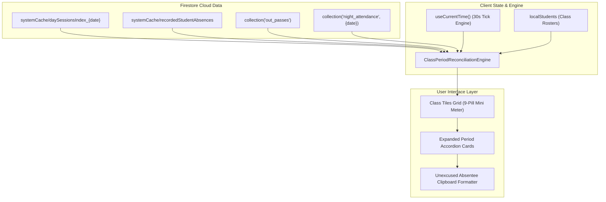

# Real-Time Class & Period Attendance Monitor

*   **Author:** safmuzammil
*   **Status:** Approved
*   **Date:** 2026-11-10

--------------------------------------------------------------------------------

## Overview

The Real-Time Class & Period Attendance Monitor is a live supervisory dashboard for Administrators, Office Secretaries, and Class Teachers (strictly scoped to their assigned class) within `mark-entry-app`. It evaluates attendance completion across Darul Huda Degree Institution's 9-period bell schedule (P1 07:45 through P9 15:30).

Rather than displaying unrecorded periods as arbitrary absences or assuming default presence, the monitor mathematically reconciles split-teacher subject cohorts within each class. It presents class tiles that expand into period status cards displaying total students in class, taken vs untaken count, and present vs absent counts. For unexcused absent students (excluding approved medical leave, official duties, and gate outpasses), one-click clipboard copying formats their details (admission number and name) for instant WhatsApp reporting to check why they are not in class.

## The Problem

1. **Blind Spots Across 9 Daily Periods**: Administrators and office secretaries cannot easily verify if each class's period attendance was taken on time according to the daily bell schedule without manually clicking through separate teacher subject batches.
2. **False Assumptions from Untaken Sessions**: In split-stream classes (e.g. QLA3 where different groups study Urdu, Arabic, or specialized electives simultaneously), if one teacher forgets or is late taking attendance, standard reports can falsely show those students as absent or present, creating severe data distortion.
3. **Delayed Action on Delinquent Roll Calls**: Currently, missing period attendances are only noticed hours later or during night tallying, making timely classroom verification and campus discipline enforcement difficult.
4. **Friction in Absentees Communication**: Staff members and class teachers need to quickly communicate strictly unexcused absent student lists (students who ought to be in class during roll call but are absent without an approved outpass or medical/official leave) to staff and class WhatsApp groups without manual filtering.

## Goals

*   **G1: Live 9-Period Bell Schedule Tracking**: Continuously evaluate the current time against the 9-period bell schedule (P1 07:45 to P9 15:30) and render visual period state transitions (`Scheduled`, `In Progress`, `Overdue / Untaken`, `Partial`, `Completed`).
*   **G2: Multi-Teacher Split Stream Reconciliation**: Accurately calculate Taken vs Untaken student rosters per class-period slot, ensuring unrecorded student subsets are never marked as present or absent.
*   **G3: Role-Scoped Visibility**: Provide full institution-wide monitoring for Admins and Office Secretaries while strictly scoping Class Teachers to their designated classes (`myCtClasses`).
*   **G4: One-Click Unexcused Absentee Clipboard Export**: Allow administrators and class teachers to copy formatted text containing strictly unexcused absent students (omitting approved outpasses, medical leaves, and official duties) directly to the system clipboard for WhatsApp distribution.
*   **G5: Zero-Overhead Memory Joining**: Deliver reactive updates by consuming existing client datasets (`systemCache/daySessionsIndex_${attDate}`, `localStudents`, `recordedAbsencesByReg`, `activeOutpassesByReg`) with zero additional Firestore reads or new collections.

## Non-Goals

*   **NG1: Direct Attendance Editing Inside Monitor**: The monitor is strictly a supervisory inspection and copying tool. Subject teachers and class teachers continue to record roll calls via the established Period Attendance and Night Attendance workflows.
*   **NG2: Automated Bot WhatsApp Messaging**: Automated background WhatsApp API dispatching is out of scope. The feature delivers structured text copying to the user's clipboard for manual forwarding.
*   **NG3: Modifying Firestore Data Models**: No schema changes or new Firestore collections are created for storing monitoring snapshots.

## Open Questions

*   **OQ1**: What grace period threshold is optimal after period start before a session transitions to `Overdue`? (Defaulting to 15 minutes).
*   **OQ2**: Should classes with no scheduled period on specific timetable days be designated as `Free Period` automatically if zero enrollments match that slot?

--------------------------------------------------------------------------------

## Critical User Journeys (CUJs)

### CUJ 1: Administrator Inspects Split-Cohort Class (QLA3) with Partial Submission

*   **Given**: An Administrator or Office Secretary opens the Live Period Attendance Monitor at 10:40 AM (during Period 4, scheduled 10:25 - 11:10). Class QLA3 has 34 students enrolled: 16 in the Urdu stream taught by Usthad Tariq and 18 in the Arabic stream taught by Usthad Hamza.
*   **When**: Usthad Tariq has submitted attendance for the Urdu cohort (15 Present, 1 Unexcused Absent), while Usthad Hamza has not yet submitted roll call for the Arabic cohort.
*   **Then**:
    1. The QLA3 class tile displays Period 4 with an amber `Partial` badge indicating `16/34 Recorded (18 Untaken)`.
    2. Expanding the Period 4 card displays:
       * Total Enrolled: 34
       * Attendance Taken: 16 (15 Present, 1 Absent)
       * Attendance Untaken: 18
    3. The 18 untaken students are cleanly segregated under an "Untaken Roster" section and are **not** counted as absent or present.
    4. Clicking the "Copy Unexcused Absentees" button copies only the single unexcused absent student (`#1105 - Salman Faris`) to the clipboard, formatted for instant communication.

### CUJ 2: Class Teacher Monitors Assigned Class Across 9 Periods

*   **Given**: A teacher logged in who is designated as Class Teacher for `HFC3` navigates to the Period Attendance module and selects the "Live Monitor" tab.
*   **When**: The teacher views the dashboard.
*   **Then**:
    1. The view is strictly scoped to `HFC3`; other institutional classes are hidden.
    2. The 9-period progress pills show live status: P1 to P3 `Completed`, P4 `In Progress`, P5 to P9 `Scheduled`.
    3. Period 2 has 2 non-present students: 1 student on an approved Gate Outpass and 1 unexcused absent student.
    4. Clicking "Copy Unexcused Absentees" on Period 2 copies strictly the single unexcused absent student's details, omitting the student on the approved gate outpass.
    5. The teacher pastes the clean text into the staff/class WhatsApp group to inquire why the student missed roll call.

### CUJ 3: Scheduled Rehearsal & Arts Session Preemption

*   **Given**: An Event Leader records an institutional rehearsal session `FN2` (which officially spans periods P5 and P6) for participating students across multiple classes.
*   **When**: The 11:20 AM bell rings for Period 5.
*   **Then**:
    1. The monitor cross-references `FN2` session records for the day.
    2. Classes whose students are in the approved rehearsal session are marked with a blue `Rehearsal Session Active` status badge instead of triggering a false `Overdue / Untaken` alert for standard classroom teachers.
    3. Individual student statuses reflect their event attendance rather than unexcused absenteeism.

--------------------------------------------------------------------------------

## Technical Plan (Architecture)

### 1. Architectural Component Map

The monitor is structured as a client-side reactive projection component (`app/components/ClassPeriodMonitorTab.jsx`) embedded directly into `app/components/PeriodAttendanceManager.jsx`. It requires zero additional Firestore writes or backend services.



### 2. Core Data Structures & Time State Machine

#### Bell Schedule Definition
```javascript
export const BELL_SCHEDULE = [
  { period: 1, label: 'Period 1', start: '07:45', end: '08:30', slot: 'P1' },
  { period: 2, label: 'Period 2', start: '08:30', end: '09:15', slot: 'P2' },
  { period: 3, label: 'Period 3', start: '09:40', end: '10:25', slot: 'P3' },
  { period: 4, label: 'Period 4', start: '10:25', end: '11:10', slot: 'P4' },
  { period: 5, label: 'Period 5', start: '11:20', end: '12:05', slot: 'P5' },
  { period: 6, label: 'Period 6', start: '12:05', end: '12:50', slot: 'P6' },
  { period: 7, label: 'Period 7', start: '14:00', end: '14:40', slot: 'P7' },
  { period: 8, label: 'Period 8', start: '14:40', end: '15:20', slot: 'P8' },
  { period: 9, label: 'Period 9', start: '15:30', end: '16:15', slot: 'P9' },
];
```

#### State Transition Logic
```javascript
export function evaluatePeriodStatus(now, scheduleSlot, takenCount, totalEnrolled, graceMinutes = 15) {
  const [sH, sM] = scheduleSlot.start.split(':').map(Number);
  const [eH, eM] = scheduleSlot.end.split(':').map(Number);
  
  const startMs = new Date(now).setHours(sH, sM, 0, 0);
  const endMs = new Date(now).setHours(eH, eM, 0, 0);
  const graceMs = startMs + graceMinutes * 60 * 1000;
  const nowMs = now.getTime();

  if (totalEnrolled > 0 && takenCount >= totalEnrolled) {
    return 'COMPLETED'; // 🟢 All students in class accounted for
  }
  if (takenCount > 0 && takenCount < totalEnrolled) {
    return 'PARTIAL'; // 🟠 Multi-teacher split cohort partially submitted
  }
  if (nowMs < startMs) {
    return 'SCHEDULED'; // ⚪ Upcoming period
  }
  if (nowMs >= startMs && nowMs <= graceMs) {
    return 'IN_PROGRESS'; // 🟡 Active period within grace period
  }
  return 'OVERDUE'; // 🔴 Period elapsed past grace threshold without submission
}
```

#### Split-Cohort Reconciliation Logic
For any target class $C$ and period $P$:
1. `classStudents`: All students where `s.class === C || s.classes?.includes(C)`.
2. `recordedSessions`: Filter `daySessionsIndex[attDate]` where session period equals $P$ and class matches $C$.
3. Build a lookup map of recorded student registration numbers:
   $$\text{RecordedRegs} = \bigcup_{S \in \text{recordedSessions}} \text{keys}(S.\text{attendanceMap})$$
4. Categorize students:
   * $\text{TakenStudents} = \{ s \in \text{classStudents} \mid s.\text{regNo} \in \text{RecordedRegs} \}$
   * $\text{UntakenStudents} = \{ s \in \text{classStudents} \mid s.\text{regNo} \notin \text{RecordedRegs} \}$
5. For taken students:
   * Status is resolved against active outpasses, medical leave, or night attendance absence records.
   * A student is marked **Unexcused Absent** if status is `'A'` and neither an active outpass nor a pre-recorded medical/official leave exists.

### 3. Clipboard Export Template (Unexcused Absentees Only)

```text
📋 *UNEXCUSED ABSENTEES REPORT*
🏫 *Darul Huda Degree Institution*
📚 *Class:* {className}
⏰ *Period:* {periodLabel} ({timeWindow}) | {date}
📊 *Roster:* {totalEnrolled} Enrolled | {takenCount} Recorded ({untakenCount} Untaken)

⚠️ *STUDENTS REQUIRING CLASS TEACHER VERIFICATION:*
1. *#{rollNo}* - {studentName} (Ad.No: {adNo})
2. *#{rollNo}* - {studentName} (Ad.No: {adNo})

_Total Unexcused Missing: {unexcusedCount}_
_Generated via MarkPortal Live Monitor_
```

--------------------------------------------------------------------------------

## Alternatives Considered

### Alternative A: Scheduled Cloud Function Aggregator
*   **Approach**: Run a scheduled Cloud Function every 15 minutes that evaluates teacher submissions and writes class-period summary documents to a new `period_monitoring_cache` collection.
*   **Pros**: Offloads reconciliation calculation from the client.
*   **Cons**: Introduces 300+ extra Firestore writes per day, subject to cold starts, delays real-time feedback when a teacher submits roll call, and incurs billing overhead.
*   **Reason for Rejection**: The existing web app already maintains `localStudents` in memory and listens reactively to `systemCache/daySessionsIndex_${attDate}`. In-memory joining executes in under 2ms per render with zero backend infrastructure.

### Alternative B: Direct Multi-Document Collection Reads
*   **Approach**: For every class and period, fetch individual session documents from `systemCache/periodSession_*`.
*   **Pros**: Explicit document-level tracking.
*   **Cons**: Would trigger up to 360 individual Firestore reads per page load, quickly exhausting daily read quotas on the Spark/Blaze plan.
*   **Reason for Rejection**: `daySessionsIndex` already centralizes the day's session metadata and attendance maps in a single document.

--------------------------------------------------------------------------------

## Non-Functional Requirements

*   **Security & Privacy**:
    *   Admins and Office Secretaries have unrestricted visibility across all classes.
    *   Class Teachers are strictly restricted via `myCtClasses` matching to prevent unauthorized surveillance of other classrooms.
*   **Performance & Latency**:
    *   Reconciliation runs client-side using memoized useMemo hooks (`useMemo(..., [todayRecordedSessions, localStudents, activeOutpassesByReg])`).
    *   The 30-second clock tick only recalculates period states (`evaluatePeriodStatus`), avoiding full roster re-indexing.
*   **Offline Resilience**:
    *   If a user loses internet connectivity, the monitor seamlessly renders the last known cached snapshot from localStorage without crashing or showing blank states.

--------------------------------------------------------------------------------

## Future Improvements

*   **1. Automated Staff WhatsApp Link Generation**: Option to open WhatsApp Web directly addressed to the class teacher with the unexcused absentee list pre-filled in the text query param.
*   **2. Daily Aggregate Class Report**: A header-level summary on each class tile displaying aggregate attendance completion percentage across all 9 periods combined.

--------------------------------------------------------------------------------

## Detailed Implementation Plan

### Target Files to Create/Modify

#### 1. `app/components/ClassPeriodMonitorTab.jsx` (Create)

*   **Type / Scope**: React Client Component
*   **Proposed Logic**:
    *   **Bell Schedule Engine**: Embeds `BELL_SCHEDULE` definition and a 30-second interval timer hook (`useCurrentTime()`) to dynamically calculate period status (`Scheduled`, `In Progress`, `Overdue`, `Partial`, `Completed`) against institution bell times.
    *   **Role-Based Access Filter**:
        *   If `userRole === 'admin' || userRole === 'office_secretary'`: Displays all institutional classes (`DEFAULT_CLASSES`).
        *   If `userRole === 'teacher'`: Filters strictly for classes where `myCtClasses.includes(className)`. If the teacher is not a class teacher, displays a clean access notice.
    *   **Roster Reconciliation**:
        *   Iterates through each class and each period 1..9.
        *   Aggregates sessions recorded in `todayRecordedSessions` matching class and period.
        *   Extracts student registration numbers from session `attendanceMap`.
        *   Calculates `takenCount`, `untakenCount`, `presentCount`, `absentCount`, `medicalCount`, and `outpassCount`.
        *   Identifies students who are strictly **Unexcused Absent** (marked `'A'` and having neither an active gate outpass nor a pre-recorded absence/medical leave).
    *   **Interactive UI Hierarchy**:
        *   **Class Tiles Grid**: Each tile displays the class name, total enrolled students, overall completion percentage, and a horizontal 9-segment mini-pill progress bar.
        *   **Period Expansion Drawer**: Clicking a class tile opens its 9 period cards. Each period card shows the time window, status badge, taken vs untaken metrics, and present vs absent breakdowns.
        *   **Student Details Drawer**: Clicking absent or untaken counters opens the detailed roster view.
        *   **One-Click Clipboard Export**: An action button `📋 Copy Unexcused Absentees` generates formatted text for strictly unexcused absent students and copies it to `navigator.clipboard` with visual toast confirmation.

#### 2. `app/components/PeriodAttendanceManager.jsx` (Modify)

*   **Type / Scope**: Parent Controller Component
*   **Proposed Changes**:
    *   Import `ClassPeriodMonitorTab`.
    *   Add a new sub-tab `live_monitor` to the tab bar (e.g. `Subject Cards`, `Live Monitor`, `Reports Hub`, `Shortage <85%`).
    *   Render `<ClassPeriodMonitorTab />` when active, passing:
        *   `loggedInUser`
        *   `userRole`
        *   `localStudents`
        *   `localTeachers`
        *   `activeOutpassesByReg`
        *   `recordedAbsencesByReg`
        *   `todayRecordedSessions`
        *   `attDate`
        *   `myCtClasses`

#### 3. `app/components/AdminDashboard.jsx` (Modify)

*   **Type / Scope**: Main Dashboard Component
*   **Proposed Changes**:
    *   Add a quick-access tile or header link for Administrators and Office Secretaries that routes directly to the `live_monitor` tab in Period Attendance for instant period oversight.

---

### Verification Plan

*   **Build Verification**:
    *   Run `npm run build` in PowerShell sandbox mode to ensure zero Next.js compilation, TypeScript, or JSX syntax errors.
*   **Functional Test Cases**:
    1.  *Bell Schedule State Accuracy*: Verify that a period scheduled in the future displays as `Scheduled`, an active period within 15 minutes displays as `In Progress`, and an unrecorded elapsed period displays as `Overdue`.
    2.  *Split-Cohort Segregation*: Verify that in QLA3, when only 1 of 2 concurrent subject teachers records roll call, the period is marked `Partial`, untaken students remain distinct, and untaken students are neither marked present nor absent.
    3.  *Clipboard Copy Integrity*: Verify that clicking "Copy Unexcused Absentees" copies strictly unexcused absent students, explicitly omitting students with approved gate outpasses, hospital stays, or official duty leaves.
    4.  *Role Enforcement*: Verify that an account with `userRole: 'teacher'` and `myCtClasses: ['HFC3']` can only see the HFC3 card and cannot inspect other class cohorts.

--------------------------------------------------------------------------------

*Drafted with EGM*
