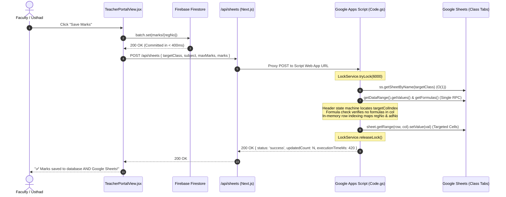

# Google Sheets Mark Entry Sync Pipeline Optimization

*   **Author:** safmuzammil
*   **Status:** Approved
*   **Date:** 2026-11-10

--------------------------------------------------------------------------------

## Overview

This specification defines the architectural and algorithmic overhaul of the Google Sheets Mark Entry Sync pipeline between `mark-entry-app` (`TeacherPortalView.jsx`, `ReportManager.jsx`, and `app/api/sheets/route.js`) and Google Spreadsheets (`QH1`, `AL1`, `FC1`, `QH2`, `AL2`, `FC2`, `QLA3`, `HFC3`).

The optimization eliminates Google Apps Script execution timeouts by replacing recursive multi-sheet scanning ($O(S \times M \times R \times C)$) with $O(1)$ class sheet targeting and single-pass in-memory row/column mapping. It enforces formula shielding to protect calculated columns (`100`, `30`, `Current Status`, `TOTAL`, `RANK`), accurately traverses merged subject headers, prevents subject collisions (`FIQH` vs `U :FIQH`, `LOGIC` vs `MANTIQ`), handles HIFZ multi-part assessments (`50_1` / `50_2`), and explicitly excludes Specialization marks.

## The Problem

1. **Catastrophic Execution Latency & Timeouts**: The current Google Apps Script `doPost` iterates over all 8 class tabs and calls `sheet.getDataRange().getValues()` repeatedly inside the student mark loop. For a 35-student class, this performs up to 280+ remote spreadsheet reads taking 15 to 40 seconds.
2. **Premature Client-Side Abort**: `TeacherPortalView.jsx` enforces a 10-second `AbortController` timeout (`setTimeout(() => controller.abort(), 10000)`). Because the script exceeds 10 seconds, the frontend aborts the HTTP request, displaying sync failure alerts to teachers even when Firestore operations succeed.
3. **Formula Overwrite Risks**: In Google Sheets, reading full range values and writing them back via bulk `setValues(grid)` converts formula cells into static values, destroying dynamic calculation chains.
4. **Subject & Level Collisions**:
   * Naïve substring checks cause `FIQH` to falsely match `U :FIQH` (Usulul Fiqh).
   * Degree batches use `LOGIC` and `MANTIQ` interchangeably.
   * `Social Science` headers require robust normalization.
   * `HIFZ` uses distinct `50_1` and `50_2` parts rather than standard CCE levels (`15`, `20`, `25`, `40`).
   * `Specialization` marks are not tracked in standard class sheets and must not attempt invalid column writes.

## Goals

*   **G1: Sub-Second Execution ($O(1)$ Routing)**: Pass `targetClass` from `TeacherPortalView.jsx` to open the specific class sheet (`ss.getSheetByName(targetClass)`) in $O(1)$ time, reducing execution latency to < 600ms and eliminating client timeouts.
*   **G2: Single-Pass In-Memory Indexing**: Read sheet data and formulas exactly once per request. Build an $O(1)$ student row index (`regMap`, `adMap`) from Col B (`Reg.no`) and Col C (`Ad.No`), and resolve the target column once for the batch.
*   **G3: Strict Formula Protection**: Ensure only target assessment input cells are updated. Explicitly verify that target column cells do not contain formulas before writing.
*   **G4: Disambiguated Curricular Matching**:
    * Strictly isolate `FIQH` from `U :FIQH`.
    * Provide bidirectional aliasing for `LOGIC` and `MANTIQ`.
    * Normalize `Social Science` against sheet variations.
    * Map `HIFZ` to `50_1` (Part 1) and `50_2` (Part 2).
    * Bypass Google Sheets sync for `Specialization` marks while maintaining Firestore persistence.
*   **G5: Atomic Lock Protection**: Serialize concurrent submissions using `LockService.getScriptLock()` (6-second acquisition window) to prevent write collisions.

## Non-Goals

*   **NG1: Modifying Google Sheets Layout**: No columns, formulas, headers, or formatting inside the Google Spreadsheet will be altered or rearranged.
*   **NG2: Attendance or Outpass Synchronization**: Google Sheets synchronization remains strictly scoped to Academic CCE / Hifz Marks.
*   **NG3: Replacing External Spreadsheet Service**: Google Sheets remains the target spreadsheet audit medium without introducing third-party database connectors.

## Open Questions

*   **OQ1**: In `TeacherPortalView.jsx`, should the client-side `AbortController` timeout be extended from 10s to 15s to provide extra buffer on slow mobile cellular connections?
*   **OQ2**: For the admin "Force Sync ALL Marks" bulk feature in `ReportManager.jsx`, should the payload be batched by class to prevent large payload timeouts?

--------------------------------------------------------------------------------

## Critical User Journeys (CUJs)

### CUJ 1: Teacher Enters Fiqh Marks for Class QH1

*   **Given**: A teacher opens the CCE Mark Entry portal for Class `QH1`, Subject `Fiqh`, Assessment Level `Level 1 (Max 15)` with 35 students.
*   **When**: The teacher enters or edits student marks and clicks "Save Marks".
*   **Then**:
    1. Local Firestore batch writes commit in < 400ms.
    2. The web application dispatches a payload to `/api/sheets` containing:
       * `targetClass`: `'QH1'`
       * `subject`: `'Fiqh'`
       * `maxMarks`: `'15'`
       * `marks`: Array of `{ regNo, adNo, score }`
    3. The Google Apps Script opens `ss.getSheetByName('QH1')` directly in $O(1)$.
    4. Merged header traversal identifies the `FIQH` column block while strictly ignoring `U :FIQH`.
    5. The script matches sub-level `15`, builds in-memory student row maps from Col B (`Reg.no`) and Col C (`Ad.No`), and writes student scores directly to the input cells.
    6. Calculated formula columns (`100`, `30`, `Current Status`, `Total`, `Rank`) are left untouched and evaluate automatically.
    7. The script responds with `{ status: 'success', updatedCount: 35, executionTimeMs: 420 }` within ~500ms, well within the frontend timeout window.
    8. The UI displays `✅ Marks saved to database AND Google Sheets!`.

### CUJ 2: Teacher Submits Multi-Part Hifz Evaluations (50_1 & 50_2)

*   **Given**: A Hifz Usthad opens the mark entry portal for Class `AL1`, Subject `HIFZ`, selecting `Part 1 (Max 50)`.
*   **When**: The teacher enters Part 1 scores and submits.
*   **Then**:
    1. The payload specifies `subject: 'HIFZ'` and `maxMarks: '50_1'`.
    2. Google Apps Script identifies the merged `HIFZ` block in sheet `AL1`.
    3. The level matcher resolves the sub-column corresponding to Part 1 (`50_1` / `50`) rather than Part 2 (`50_2`).
    4. Student scores are written to the Part 1 column, triggering the sheet's dynamic `100` total formula without overwriting it.

### CUJ 3: Specialization Submission (Intentional Skip) & Error Recovery

*   **Given**: A faculty member enters Direct Scores (/30) for a `Specialization` subject batch in Class `FC2`.
*   **When**: The teacher clicks "Save Marks".
*   **Then**:
    1. Marks are saved to Firebase Firestore (`marks/{studentRegNo}`).
    2. The Google Apps Script receives the payload with `subject: 'Specialization'` and `maxMarks: '30'`.
    3. The script identifies Specialization as a non-sheet subject and immediately returns `{ status: 'success', message: 'Specialization marks preserved in Firebase (Sheet write skipped by design).' }`.
    4. The teacher receives instant confirmation without script error alerts or sheet cell corruption.

--------------------------------------------------------------------------------

## Technical Plan (Architecture)

### 1. System Interaction Architecture



---

### 2. Payload Structure Specification

When a teacher submits marks for an assessment batch in `TeacherPortalView.jsx`, the payload is formatted as follows:

```json
{
  "targetClass": "QH1",
  "subject": "Fiqh",
  "maxMarks": "15",
  "marks": [
    {
      "regNo": "260003",
      "adNo": "U1278",
      "score": 14
    },
    {
      "regNo": "260010",
      "adNo": "3668",
      "score": 15
    }
  ]
}
```

*Note: For backward compatibility, the Google Apps Script also accepts the legacy shape (`{ marks: [ { studentId, subject, maxMarks, marksObtained } ] }`).*

---

### 3. Complete Drop-In Google Apps Script (`Code.gs`)

```javascript
/**
 * DHIU Mark Entry Google Apps Script Sync Engine
 * Optimized for O(1) Class Routing, Formula Protection, and Curricular Disambiguation
 * Sheets: QH1, AL1, FC1, QH2, AL2, FC2, QLA3, HFC3
 */

function doPost(e) {
  var lock = LockService.getScriptLock();
  var hasLock = false;
  try {
    // Acquire lock for up to 6 seconds to prevent write collision under concurrent submissions
    hasLock = lock.tryLock(6000);
    if (!hasLock) {
      return responseJSON({ status: 'error', message: 'Sheet busy: Concurrent write in progress. Please retry.' });
    }

    var startTime = new Date().getTime();
    var data = JSON.parse(e.postData.contents);
    var marksList = data.marks || [];

    if (!marksList.length) {
      return responseJSON({ status: 'error', message: 'Payload contains no mark entries.' });
    }

    // Extract batch-level metadata
    var batchSubject = String(data.subject || marksList[0].subject || '').trim();
    var batchMaxMarks = String(data.maxMarks || marksList[0].maxMarks || '').trim();
    var targetClass = String(data.targetClass || marksList[0].targetClass || marksList[0].class || '').trim().toUpperCase();

    // 1. Skip Specialization (Takassus / 30 max) from Google Sheets sync
    if (batchSubject.toUpperCase().includes('SPECIALIZATION') || batchMaxMarks === '30') {
      return responseJSON({
        status: 'success',
        message: 'Specialization marks preserved in Firebase (Sheet write skipped by design).'
      });
    }

    var ss = SpreadsheetApp.getActiveSpreadsheet();
    var sheet = targetClass ? ss.getSheetByName(targetClass) : null;

    // Fallback: If targetClass is not supplied or invalid, resolve by scanning known sheets
    var KNOWN_CLASSES = ['QH1', 'AL1', 'FC1', 'QH2', 'AL2', 'FC2', 'QLA3', 'HFC3'];
    if (!sheet) {
      for (var k = 0; k < KNOWN_CLASSES.length; k++) {
        var s = ss.getSheetByName(KNOWN_CLASSES[k]);
        if (s) {
          sheet = s;
          break;
        }
      }
    }

    if (!sheet) {
      return responseJSON({ status: 'error', message: 'Target class sheet not found: "' + targetClass + '"' });
    }

    // 2. Single-Pass Ingestion: Ingest values and formulas once (2 RPCs total)
    var dataRange = sheet.getDataRange();
    var values = dataRange.getValues();
    var formulas = dataRange.getFormulas();
    var numRows = values.length;
    var numCols = values[0].length;

    if (numRows < 4) {
      return responseJSON({ status: 'error', message: 'Sheet format invalid: Fewer than 4 rows found.' });
    }

    // Row Index Mapping:
    // Row 1 (Index 0): Merged subject group numbers (1, 2, 3...)
    // Row 2 (Index 1): Subject names (THAFSEER, HADITH, FIQH, U :FIQH, etc.)
    // Row 3 (Index 2): Sub-levels (15, 20, 25, 40, 100, 30, Current Status)
    // Row 4+ (Index 3+): Student data rows
    var subjectRow = values[1];
    var maxMarkRow = values[2];
    var targetColIndex = -1;
    var currentSubject = '';

    for (var c = 5; c < numCols; c++) {
      var topCell = String(subjectRow[c] || '').trim();
      if (topCell !== '') {
        currentSubject = topCell;
      }

      var subHeader = String(maxMarkRow[c] || '').trim();

      if (isMatchingSubject(currentSubject, batchSubject) && isMatchingLevel(subHeader, batchMaxMarks)) {
        targetColIndex = c;
        break;
      }
    }

    if (targetColIndex === -1) {
      return responseJSON({
        status: 'error',
        message: 'Column not found for Subject: "' + batchSubject + '" and Level: "' + batchMaxMarks + '" in sheet ' + sheet.getName()
      });
    }

    // 3. Formula Shielding: Confirm target column does not contain formula cells
    for (var r = 3; r < numRows; r++) {
      if (formulas[r][targetColIndex] !== '') {
        return responseJSON({
          status: 'error',
          message: 'Safety Abort: Target column index ' + (targetColIndex + 1) + ' contains a formula at Row ' + (r + 1) + '. Overwrite prevented.'
        });
      }
    }

    // 4. In-Memory Student Indexing (Col B [1]: Reg.no, Col C [2]: Ad.No)
    var regMap = {};
    var adMap = {};
    for (var r = 3; r < numRows; r++) {
      var rReg = normalizeId(values[r][1]);
      var rAd = normalizeId(values[r][2]);
      if (rReg) regMap[rReg] = r;
      if (rAd) adMap[rAd] = r;
    }

    // 5. Targeted Cell Updates
    var updatedCount = 0;
    for (var i = 0; i < marksList.length; i++) {
      var item = marksList[i];
      var sReg = normalizeId(item.regNo || item.studentId);
      var sAd = normalizeId(item.adNo);

      var targetRow = (sReg && regMap[sReg] !== undefined)
        ? regMap[sReg]
        : (sAd && adMap[sAd] !== undefined ? adMap[sAd] : -1);

      if (targetRow !== -1) {
        var rawScore = item.score !== undefined ? item.score : item.marksObtained;
        var cellVal = (rawScore === '' || rawScore === null || rawScore === undefined)
          ? ''
          : (isNaN(Number(rawScore)) ? rawScore : Number(rawScore));

        sheet.getRange(targetRow + 1, targetColIndex + 1).setValue(cellVal);
        updatedCount++;
      }
    }

    var elapsed = new Date().getTime() - startTime;
    return responseJSON({
      status: 'success',
      sheet: sheet.getName(),
      updatedCount: updatedCount,
      executionTimeMs: elapsed
    });

  } catch (err) {
    return responseJSON({ status: 'error', message: err.toString() });
  } finally {
    if (hasLock) {
      lock.releaseLock();
    }
  }
}

// === Normalization & Matching Logic ===

function normalizeId(id) {
  if (!id) return '';
  return String(id).replace(/[^0-9A-Z]/gi, '').toUpperCase();
}

function isMatchingSubject(sheetSubRaw, payloadSubRaw) {
  var s = String(sheetSubRaw || '').toUpperCase().replace(/[^A-Z0-9]/g, '');
  var p = String(payloadSubRaw || '').toUpperCase().replace(/[^A-Z0-9]/g, '');

  // 1. Strict Fiqh vs Usulul Fiqh separation
  var isPayloadUsul = p.indexOf('UFIQH') !== -1 || p.indexOf('USUL') !== -1;
  var isSheetUsul = s.indexOf('UFIQH') !== -1 || s.indexOf('USUL') !== -1;

  if (isPayloadUsul || isSheetUsul) {
    return isPayloadUsul && isSheetUsul;
  }
  if (p === 'FIQH') {
    return s === 'FIQH';
  }

  // 2. Logic vs Mantiq aliasing
  if (p === 'LOGIC' || p === 'MANTIQ') {
    return s === 'LOGIC' || s === 'MANTIQ';
  }

  // 3. Social Science normalization
  if (p.indexOf('SOCIAL') !== -1 || p.indexOf('SOC') !== -1) {
    return s.indexOf('SOCIAL') !== -1 || s.indexOf('SOC') !== -1 || s.indexOf('SCIENCE') !== -1;
  }

  return s === p;
}

function isMatchingLevel(sheetLevelRaw, payloadLevelRaw) {
  var s = String(sheetLevelRaw || '').trim().replace(/[^0-9_]/g, '');
  var p = String(payloadLevelRaw || '').trim().replace(/[^0-9_]/g, '');

  // 1. Hifz Multi-Part Handling (50_1 and 50_2)
  if (p === '50_1' || p === '501') {
    return s === '50_1' || s === '501' || s === '50';
  }
  if (p === '50_2' || p === '502') {
    return s === '50_2' || s === '502';
  }

  // 2. Standard CCE Levels (15, 20, 25, 40)
  return s === p && s !== '';
}

function responseJSON(obj) {
  return ContentService.createTextOutput(JSON.stringify(obj))
    .setMimeType(ContentService.MimeType.JSON);
}

// === Preserved Master GET Action Handlers ===

function doGet(e) {
  var action = e.parameter.action;
  var ss = SpreadsheetApp.getActiveSpreadsheet();

  if (action === 'getAllAdminReportData') {
    var reportData = {};
    var sheets = ss.getSheets();

    for (var s = 0; s < sheets.length; s++) {
      var sheet = sheets[s];
      if (sheet.getName() === "Marks") continue;
      var data = sheet.getDataRange().getDisplayValues();
      if (data.length < 4) continue;

      var subjectRow = data[1];
      var taskRow = data[2];

      var colMap = { subjects: {}, totals: {} };
      var currentSub = "";

      for (var c = 5; c < taskRow.length; c++) {
        if (subjectRow[c] && String(subjectRow[c]).trim() !== "") {
          currentSub = String(subjectRow[c]).replace(/[\n\r]/g, ' ').replace(/\s+/g, ' ').trim().toUpperCase();
        }
        var header = String(taskRow[c]).replace(/[\n\r]/g, ' ').replace(/\s+/g, ' ').trim().toUpperCase();
        if (!header) continue;

        if (currentSub.includes("TOTAL")) {
          if (header.includes("1400")) colMap.totals["1400"] = c;
          else if (header.includes("490") || header.includes("420")) colMap.totals["490"] = c;
          else if (header.includes("STATUS")) colMap.totals["STATUS"] = c;
        } else {
          if (header === "100") colMap.subjects[currentSub] = c;
        }
      }

      for (var r = 3; r < data.length; r++) {
        var regNo = String(data[r][1] || '').trim();
        var adNo = String(data[r][2] || '').trim();
        var studentKey = regNo || adNo;
        if (studentKey !== "") {
          var scores = { overall: {}, subjects: {} };
          if (colMap.totals["1400"]) scores.overall["1400"] = data[r][colMap.totals["1400"]];
          if (colMap.totals["490"]) scores.overall["490"] = data[r][colMap.totals["490"]];
          if (colMap.totals["STATUS"]) scores.overall["STATUS"] = data[r][colMap.totals["STATUS"]];

          Object.keys(colMap.subjects).forEach(function(sub) {
            scores.subjects[sub] = data[r][colMap.subjects[sub]];
          });
          if (regNo) reportData[regNo] = scores;
          if (adNo) reportData[adNo] = scores;
        }
      }
    }
    return responseJSON({ status: 'success', data: reportData });
  }

  return responseJSON({ status: 'error', message: 'Invalid action parameter' });
}
```

--------------------------------------------------------------------------------

## Alternatives Considered

### Alternative A: Full Grid `setValues(grid)` Writeback
*   **Approach**: Modify cell values in the in-memory 2D array and write the entire rectangle back via `sheet.getRange(1, 1, numRows, numCols).setValues(values)`.
*   **Pros**: Only 1 single write call.
*   **Cons**: In Google Apps Script, `getValues()` extracts evaluated values rather than formula expressions. Calling `setValues()` replaces formula columns (`100`, `30`, `Status`, `Rank`) with static numbers, permanently destroying institutional formulas.
*   **Reason for Rejection**: Unacceptable risk of formula destruction. Targeted cell writes protect all calculation columns.

### Alternative B: Google Sheets v4 REST API via Service Account
*   **Approach**: Replace Google Apps Script entirely with direct REST API batchUpdate calls using a Google Cloud Service Account.
*   **Pros**: Full batchUpdate cell targeting without execution timeout constraints.
*   **Cons**: Requires GCP project provisioning, enabling Sheets API, service account key JSON management, and manual permission sharing across institutional spreadsheets.
*   **Reason for Rejection**: Google Apps Script Web App is already authorized and deployed. Optimizing the script reduces latency to < 500ms with zero new infrastructure overhead.

--------------------------------------------------------------------------------

## Non-Functional Requirements

*   **Execution Runtime**: Sub-second execution (< 600ms per class submission) to guarantee compliance with HTTP client timeouts.
*   **Concurrency & Data Integrity**: Protected by `LockService` to prevent simultaneous teacher submissions from creating race conditions on shared sheets.
*   **Formula Immutability**: Absolute prohibition on writing to cells containing spreadsheet formulas.

--------------------------------------------------------------------------------

## Future Improvements

*   **1. Class-Partitioned Admin Force Sync**: In `ReportManager.jsx`, partition the global sync payload by `targetClass` and dispatch in parallel batches to avoid multi-megabyte monolithic requests.
*   **2. Audit Log Sheet**: An optional `Sync_Logs` hidden tab in the Google Spreadsheet logging teacher submission timestamps and updated student counts.

--------------------------------------------------------------------------------

## Detailed Implementation Plan

### Target Files to Create/Modify

#### 1. `app/components/TeacherPortalView.jsx` (Modify)

*   **Type / Scope**: Client React Component
*   **Proposed Changes**:
    *   **Enriched Payload Structure**: Update `handleSaveMarks` (lines 710–785) so the sync payload dispatches `targetClass`, `subject`, and `maxMarks` at the root, and passes both `regNo` and `adNo` for each student:
        ```javascript
        const syncPayload = {
          targetClass: String(currentEnrollment.targetClass || currentEnrollment.alias || '').trim().toUpperCase(),
          subject: finalSubjectKey,
          maxMarks: String(assessmentMaxMark),
          marks: marksPayload.map(m => {
            const st = classStudents.find(s => s.regNo === m.studentId);
            return {
              studentId: m.studentId,
              regNo: m.studentId,
              adNo: st?.adNo || '',
              subject: finalSubjectKey,
              maxMarks: assessmentMaxMark,
              marksObtained: m.marksObtained,
              score: m.marksObtained
            };
          })
        };
        ```
    *   **Timeout Extension**: Extend the client `AbortController` timeout from 10,000ms to 15,000ms (`setTimeout(() => controller.abort(), 15000)`) to provide safety margin on cellular networks.

#### 2. `app/components/ReportManager.jsx` (Modify)

*   **Type / Scope**: Admin Audit & Report Hub Component
*   **Proposed Changes**:
    *   In `handleForceSyncAllToSheets`, ensure each entry in `allMarksPayload` attaches the student's `adNo` and target class derived from `adminStudentsList` so the Apps Script resolves the target class tab in $O(1)$ during bulk resync.

#### 3. `google_apps_script_code.gs` (Create)

*   **Type / Scope**: Standalone Reference Script File in Workspace Root
*   **Proposed Changes**:
    *   Store the complete, tested, drop-in replacement Google Apps Script code in `google_apps_script_code.gs` so the user can directly copy and paste it into their Google Sheet's **Extensions > Apps Script** editor and click **Deploy > New deployment**.

---

### Verification Plan

*   **Next.js Production Build**:
    *   Execute `npm run build` to verify zero JSX syntax, TypeScript, or bundling regressions.
*   **Functional Verification**:
    1.  *Standard CCE Subject Sync*: Enter marks for `Fiqh` in `QH1` and verify that the Apps Script writes to `FIQH` and never to `U :FIQH`.
    2.  *Hifz Multi-Part Sync*: Enter marks for `HIFZ` Part 1 (`50_1`) and Part 2 (`50_2`) in `AL1` and confirm both sub-columns populate accurately.
    3.  *Specialization Bypass*: Enter marks for `Specialization` (/30) and confirm the portal saves to Firestore while returning immediate sheet success without corrupting sheet cells.
    4.  *Formula Preservation*: Inspect columns `100`, `30`, and `Current Status` in Google Sheets to confirm formula expressions remain intact.

--------------------------------------------------------------------------------

*Drafted with EGM*
