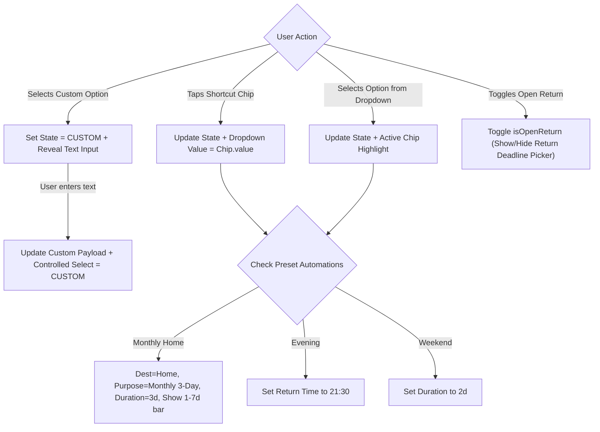

# Design Document: Universal Compact Gate Outpass Form with Native Dropdowns & Quick Chips

* **Author:** safmuzammil
* **Date:** 2026-11-11
* **Status:** Approved

---

## 1. Problem Statement

In the Gate Outpass creation portal ([`app/outpass/components/OutpassTeacherDesk.jsx`](file:///D:/Codes/mark-entry-app/app/outpass/components/OutpassTeacherDesk.jsx)), leave categories (11 buttons), destinations (11 buttons), leave purposes (10 buttons), and duration shortcuts (6 buttons) are rendered as fully expanded, multi-row button grids. 

On mobile viewports (widths 360px–412px), these 38 buttons consume more than 1,400px of vertical height. As a result, critical interaction controls—including the date/time schedule pickers, student summary cards, and the approval submit button—are pushed 3 to 4 screen heights below the fold. Faculty members and administrators must perform repetitive vertical scrolling and navigate visual clutter to issue routine passes, increasing tap friction and causing accidental mis-taps.

---

## 2. Overview

This design restructures the Gate Outpass creation desk into a compact, mobile-first interface applied universally across mobile and desktop displays:

1. **Standard Native Dropdown Pickers (`<select>`)**: Converts Leave Category, Destination, and Purpose into compact HTML `<select>` elements that invoke the mobile OS bottom selection sheet (iOS wheel picker / Android bottom dialog). All `<select>` elements enforce a 16px base font size to prevent iOS Safari auto-zooming and maintain a minimum 44px touch target height.
2. **Index-0 Custom Input Trigger**: Places `✍️ Custom ...` at option 0 of each dropdown. Selecting it reveals an inline text input directly below the dropdown. The `<select>` element retains a controlled binding to `'CUSTOM'` (or `'Custom'`) during typing, preventing unselected states, while smooth scrolling ensures soft keyboards do not occlude the input.
3. **High-Frequency Shortcut Chips**: Displays 2–3 1-tap shortcut pills alongside each dropdown for the most common institutional movements:
   * **Categories**: `🏠 Monthly Home`, `☀️ Evening`, `🕌 Friday`
   * **Destinations**: `📍 Home`, `📍 Chemmad` *(local town center)*, `📍 Bookplus` *(campus bookstore & stationery)*
   * **Purposes**: `📝 Monthly 3-Day Leave`, `📝 Medical / Hospital Case`, `📝 Personal Purchase`
   Bidirectionally mirrored with the dropdown state.
4. **Purged Duration Clutter in Section 5**: Removes the 5 fixed duration preset chips (`+1 Hr`, `+2 Hrs`, `Today 6:00 PM`, `+1 Day`, `+3 Days`) above the date picker.
5. **Flexible Teacher-Controlled Open Return**: Replaces the duration cluster with a dedicated, teacher-controlled toggle for **`🏥 Open-Ended Return (No fixed deadline)`**. For medical visits, teachers can either activate open-ended return or specify an exact expected return time.
6. **Mobile Ergonomics & Keyboard Avoidance**: Form containers provide soft-keyboard clearance padding and smooth-scroll alignment when opening custom text inputs, ensuring responsive ergonomics on small mobile screens.

---

## 3. Goals & Non-Goals

### In-Scope Goals
* **Mobile Height Optimization**: Reduce cumulative vertical form space consumed by categories, destinations, purposes, and duration shortcuts by >60%.
* **Universal Layout**: Apply the compact dropdown + shortcut chip architecture consistently across all device viewports.
* **1-Tap Workflow Preservation**: Retain rapid 1-tap selection for high-frequency movements via 2–3 shortcut chips per field.
* **Flexible Custom Entries**: Support free-form custom input across Category, Destination, and Purpose via option 0 triggers.
* **Automated Schedule Cascades**: Maintain automatic population logic (e.g., `Monthly_Home` auto-selecting Home and 3 days, `Evening` applying institutional curfew `21:30`).
* **Flexible Medical Return**: Provide a clean toggle for open-ended return while allowing fixed-time medical leaves when appropriate.
* **Keyboard Safety & Mobile Accessibility**: Prevent virtual keyboard occlusion and iOS viewport auto-zoom across all input fields.

### Out-of-Scope Non-Goals
* Modifying the Firestore schema or database security rules for `out_passes`.
* Changing barcode scanner or gate security kiosk verification operations.
* Modifying student group selection or bulk-action mechanics.

---

## 4. Technical Plan

### 4.1 Component Architecture & Form Tiering

Each selection domain follows a standardized, responsive 3-tier component pattern:

```
┌────────────────────────────────────────────────────────────────────────┐
│ Header: "2. Leave Category"                [✓ Selected: Monthly Home] │
├────────────────────────────────────────────────────────────────────────┤
│ <select> [ ✍️ Custom Category... / Monthly Home / 1_Day / Evening ... ]  │
├────────────────────────────────────────────────────────────────────────┤
│ [If Custom]: [ <input type="text" placeholder="Type custom..." /> ]    │
├────────────────────────────────────────────────────────────────────────┤
│ Shortcut Chips: [ 🏠 Monthly Home ]  [ ☀️ Evening ]  [ 🕌 Friday ]      │
└────────────────────────────────────────────────────────────────────────┘
```

#### Section 2: Leave Category
* **Native Dropdown**:
  * Option 0: `Custom` (`✍️ Custom Leave Category...`)
  * Options 1..N: Standard predefined categories (`Monthly_Home`, `1_Day`, `2_Day`, `Weekend_Thu_Sat`, `Friday`, `Evening`, `General`, `Medical`, `Outreach`, `Official`).
  * Controlled value bound to `'Custom'` whenever `isCustomCategoryActive` is true.
  * Styling: `fontSize: 16px` (avoids iOS Safari auto-zoom), `minHeight: 44px` touch target.
* **Shortcut Chips**: `🏠 Monthly Home`, `☀️ Evening`, `🕌 Friday`.
* **Automations**:
  * Selecting `Monthly_Home` displays the compact 1–7 day selector bar (`[1 Day]`, `[2 Days]`, `[3 Days]` ... `[7 Days]`), automatically sets destination to `"Home"`, purpose to `"Monthly 3-Day Home Leave"`, and applies 3-day duration.
  * Selecting `Evening` applies standard evening hostel curfew `21:30` (9:30 PM).
  * Selecting `Weekend_Thu_Sat` applies 2-day duration.
  * Selecting `Custom` displays the custom category text input with smooth scrolling into view.

#### Section 3: Destination
* **Native Dropdown**:
  * Option 0: `CUSTOM` (`✍️ Custom Destination / Place...`)
  * Options 1..N: Standard predefined places (`Home`, `Chemmad` *(local town)*, `Bookplus` *(campus bookstore)*, `Mampuram`, `Tirurangadi Hospital`, `Bank / ATM`, `Barber Shop`, `Medical Store`, `Kozhikode`, `Malappuram`).
  * Controlled value bound to `'CUSTOM'` whenever `isCustomDestActive` or non-preset string is active.
  * Styling: `fontSize: 16px`, `minHeight: 44px` touch target.
* **Shortcut Chips**: `📍 Home`, `📍 Chemmad`, `📍 Bookplus`.
* **Custom Input**: Displayed when `isCustomDestActive` or value is not in presets; selection of any preset automatically clears custom text and sets `isCustomDestActive = false`.

#### Section 4: Purpose / Reason for Leave
* **Native Dropdown**:
  * Option 0: `CUSTOM` (`✍️ Custom Purpose / Reason...`)
  * Options 1..N: Standard reasons (`Monthly 3-Day Home Leave`, `Bookplus / Stationery`, `Medical / Hospital Case`, `Friday Jumu'ah / Outing` *(Friday congregational prayer & outing)*, `Personal Purchase`, `Department / Official Work`, `Family Function / Visit`, `Dental / Eye Checkup`, `Home Leave`).
  * Controlled value bound to `'CUSTOM'` whenever `isCustomPurposeActive` or non-preset reason is active.
  * Styling: `fontSize: 16px`, `minHeight: 44px` touch target.
* **Shortcut Chips**: `📝 Monthly 3-Day Leave`, `📝 Medical / Hospital Case`, `📝 Personal Purchase`.
* **Custom Input**: Displayed when `isCustomPurposeActive` or value is not in presets; selecting a preset clears custom text and sets `isCustomPurposeActive = false`.

#### Section 5: Permitted Date & Time Schedule
* **Purged Elements**: Permanently removes `+1 Hr`, `+2 Hrs`, `Today 6:00 PM`, `+1 Day`, and `+3 Days` buttons.
* **Flexible Open Return Toggle**:
  * Renders a dedicated button/toggle: `🏥 Open-Ended Return (No fixed return deadline)`.
  * Toggling active sets `isOpenReturn = true`.
  * When `isOpenReturn === true`:
    - Hides the `To Date & Time` return deadline picker.
    - Shows an active confirmation badge: `✓ 🏥 Open-Ended Return: Return time is open-ended until student checks in at gate`.
  * When `isOpenReturn === false`:
    - Displays the standard `To Date & Time` return deadline picker.
  * If the teacher chooses `Medical` as category or purpose, `isOpenReturn` can optionally be toggled on with 1 tap, but teachers retain full freedom to set an exact return deadline for short hospital appointments.

---

### 4.2 State Machine & Bidirectional Synchronization



---

### 4.3 Modified Files

1. [`app/outpass/components/OutpassTeacherDesk.jsx`](file:///D:/Codes/mark-entry-app/app/outpass/components/OutpassTeacherDesk.jsx):
   * Replaces Category button grid with native `<select>` + 3 shortcut chips + custom input.
   * Replaces Destination button grid with native `<select>` + 3 shortcut chips + custom input.
   * Replaces Purpose button grid with native `<select>` + 3 shortcut chips + custom input.
   * Purges duration preset buttons from Section 5.
   * Restyles `Open Return` into a clean, dedicated toggle switch with descriptive status pill.

---

## 5. Alternatives Considered

1. **Custom Popover / Action Sheet Dialogs**:
   * *Rejected by author*: Increases bundle size, introduces z-index and modal layering issues in scrollable containers, and introduces touch latency compared to native OS bottom sheets on iOS and Android.

2. **Horizontal Scrolling Chip Rows (`overflow-x: auto`)**:
   * *Rejected by author*: Horizontally scrollable chips hide off-screen choices from immediate view, diminish discoverability, and frequently collide with mobile browser navigation swipe gestures.

3. **Pure Dropdowns without Any Shortcut Chips**:
   * *Rejected by author*: Forcing faculty to open the OS picker sheet for every routine pass (e.g. going to Home or Bookplus) increases tap fatigue. The 2–3 shortcut chips preserve instant 1-tap approvals for >80% of volume.

4. **Mandatory Automatic Open Return for All Medical Leaves**:
   * *Rejected by author*: Teachers frequently grant short medical passes (e.g., 2 hours for a local clinic checkup or pharmacy visit) where an expected return time is essential. Making open return an accessible toggle preserves faculty discretion.

5. **Retaining Section 5 Duration Shortcut Chips**:
   * *Rejected by author*: The 5 duration chips (`+1 Hr`, `+2 Hrs`, `6:00 PM`, etc.) occupied substantial vertical room while offering redundant functionality already supported by the date/time picker and category automations.

---

## 6. Detailed Implementation Plan

The implementation proceeds in a single unified execution plan touching the outpass presentation components and system documentation:

### Step 1: Refactor Category Section in `OutpassTeacherDesk.jsx`
* **File**: [`app/outpass/components/OutpassTeacherDesk.jsx`](file:///D:/Codes/mark-entry-app/app/outpass/components/OutpassTeacherDesk.jsx)
* **Changes**:
  * Remove unused popover toggle state variables `openCategoryList`, `openDestinationList`, and `openPurposeList`.
  * Replace the `LEAVE_CATEGORIES.map` button grid (lines 823–847) with a native `<select>` dropdown (`fontSize: 16px`, `minHeight: 44px`).
  * Define Option 0 as `value="Custom"` (`✍️ Custom Leave Category...`), followed by mapped options from `LEAVE_CATEGORIES.filter(c => c !== 'Custom')`.
  * Render 3 shortcut chips (`🏠 Monthly Home`, `☀️ Evening`, `🕌 Friday`) directly below the dropdown.
  * Bind `onChange` to invoke `handleSelectCategoryOption(e.target.value)`.
  * Retain conditional rendering of the 1–7 day duration selector when `leaveCategory === 'Monthly_Home'`.
  * Retain conditional rendering of `customCategoryText` input when `leaveCategory === 'Custom'`, using smooth scroll into view.

### Step 2: Refactor Destination Section in `OutpassTeacherDesk.jsx`
* **File**: [`app/outpass/components/OutpassTeacherDesk.jsx`](file:///D:/Codes/mark-entry-app/app/outpass/components/OutpassTeacherDesk.jsx)
* **Changes**:
  * Replace the `QUICK_DESTINATIONS.map` button grid (lines 903–945) with a native `<select>` dropdown (`fontSize: 16px`, `minHeight: 44px`).
  * Define Option 0 as `value="CUSTOM"` (`✍️ Custom Destination / Place...`), followed by mapped destinations from `QUICK_DESTINATIONS`.
  * Render 3 shortcut chips (`📍 Home`, `📍 Chemmad`, `📍 Bookplus`) directly below the dropdown.
  * Bind dropdown selection: if a standard place is chosen, update `destination`, clear any custom text, and set `isCustomDestActive = false`; if `CUSTOM` is selected, set `isCustomDestActive = true`, bind controlled `<select>` value to `'CUSTOM'`, and reveal custom text input.
  * Render the custom destination `<input>` when `isCustomDestActive || (destination && !QUICK_DESTINATIONS.includes(destination))`.

### Step 3: Refactor Purpose Section in `OutpassTeacherDesk.jsx`
* **File**: [`app/outpass/components/OutpassTeacherDesk.jsx`](file:///D:/Codes/mark-entry-app/app/outpass/components/OutpassTeacherDesk.jsx)
* **Changes**:
  * Replace the `QUICK_PURPOSES.map` button grid (lines 973–1015) with a native `<select>` dropdown (`fontSize: 16px`, `minHeight: 44px`).
  * Define Option 0 as `value="CUSTOM"` (`✍️ Custom Purpose / Reason...`), followed by mapped reasons from `QUICK_PURPOSES`.
  * Render 3 shortcut chips (`📝 Monthly 3-Day Leave`, `📝 Medical / Hospital Case`, `📝 Personal Purchase`) directly below the dropdown.
  * Bind dropdown selection: if standard reason is chosen, update `purpose`, clear custom text, and set `isCustomPurposeActive = false`; if `CUSTOM` is selected, set `isCustomPurposeActive = true`, bind controlled `<select>` value to `'CUSTOM'`, and reveal custom text input.
  * Render the custom purpose `<input>` when `isCustomPurposeActive || (purpose && !QUICK_PURPOSES.includes(purpose))`.

### Step 4: Streamline Section 5 (Date & Time Schedule) in `OutpassTeacherDesk.jsx`
* **File**: [`app/outpass/components/OutpassTeacherDesk.jsx`](file:///D:/Codes/mark-entry-app/app/outpass/components/OutpassTeacherDesk.jsx)
* **Changes**:
  * Delete the duration shortcut buttons container (lines 1049–1076): remove `+1 Hr`, `+2 Hrs`, `Today 6:00 PM`, `+1 Day`, and `+3 Days`.
  * Replace the existing open-return button (lines 1077–1093) with a dedicated, styled toggle card:
    - Button text: `🏥 Open-Ended Return (No fixed return deadline)`.
    - Active state: Emerald green background, checkmark badge, and active status text.
  * Retain conditional rendering of `To Date & Time` deadline picker: hidden when `isOpenReturn === true`, displayed when `false`.
  * Add visual confirmation pill when open return is active: `✓ 🏥 Open-Ended Return Active: Student can return at any time without a fixed deadline`.

### Step 5: Verification & Quality Assurance
* Verify responsive layout on mobile viewport emulation (iPhone SE, iPhone 14, Pixel 7 at 375px–412px width).
* Verify bidirectional synchronization between chips and dropdowns.
* Test that `Monthly_Home` continues setting destination to Home and applying 3-day duration.
* Execute `npm run build` with `BypassSandbox: true` to confirm zero compilation or TypeScript errors.
* Register finalized design in [`docs/designs/SITEMAP.md`](file:///D:/Codes/mark-entry-app/docs/designs/SITEMAP.md).
