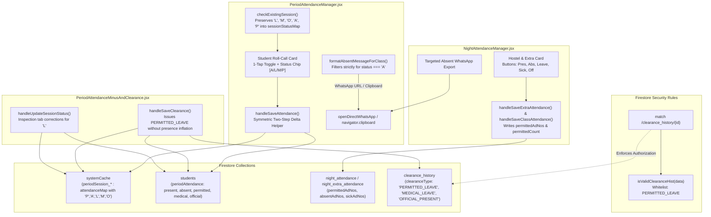

# Design Document: Permitted Leave Attendance & Targeted Absentees Export

* **Author:** safmuzammil
* **Date:** 2026-11-11
* **Status:** APPROVED

---

## 1. Problem Statement

Across Darul Huda Degree Campus, academic faculty and hostel wardens operate multiple attendance-taking portals:
1. **Period Attendance (`PeriodAttendanceManager.jsx`)**: Real-time hourly classroom lecture roll-call across 9 daily periods.
2. **Night Attendance (`NightAttendanceManager.jsx`)**: Night hostel roll-call and congregational Jamath attendance.
3. **Extra Attendance (`NightAttendanceManager.jsx`)**: Special study camps, assemblies, and extra academic sessions (managed as an operational mode within `NightAttendanceManager.jsx`).

### Institutional Jargon & Identifier Definitions
* **Jamath Attendance**: Congregational prayer attendance taken in the hostel for morning and night prayers.
* **Gate Outpass**: Kiosk-generated exit permission records stored in the `out_passes` collection, tracking whether a student is officially outside campus.
* **Clearance**: Post-hoc administrative excusal or rectification of recorded absences granted by college leadership, stored in the `clearance_history` collection.
* **Student Identifier Keys**:
  - `regNo` / document ID: The internal immutable database primary key used for Firestore student document updates and session mapping.
  - `adNo` (Admission Number): The institutional student registration identifier (`#1234` or `#U1107`) prominently displayed in campus rosters.
  - `rollNo`: Classroom seating roll number (1, 2, 3...) used by class teachers for quick roll-call verification.
* **Codebase Schema Variables**:
  - `curStat`: Refers to the `student.periodAttendance` map stored on the student document.
  - `subObj`: Refers to the specific subject entry within `curStat.subjectWise[subKey]`, tracking `present`, `permitted`, `medical`, `official`, and `absentDates`.
  - `systemCache`: The Firestore collection used for storing immutable hourly session records (`periodSession_${classId}_${date}_${period}`).

In daily operations, two systemic deficiencies impede accurate student tracking and faculty communication:

1. **Absence of a First-Class "Permitted Leave" Option**:
   - Currently, roll-call states are constrained to binary choices (`Present` vs `Absent`) or automated gate outpass/medical waivers.
   - When students obtain sanctioned departmental permissions (e.g. library research, academic competition preparation, approved family leave, or sanctioned private study), faculty must either mark them physically `PRESENT` (untrue audit record) or `ABSENT` (unfairly penalizing academic marks and triggering disciplinary absence notices).
   - In [`PeriodAttendanceManager.jsx`](file:///D:/Codes/mark-entry-app/app/components/PeriodAttendanceManager.jsx), the internal state tracks only `absentRegNos`. When an existing session is re-opened, any student not marked `'A'` or `'M'` is automatically loaded as `PRESENT`, completely wiping out any intermediate leave designations upon re-saving.
   - In [`firestore.rules`](file:///D:/Codes/mark-entry-app/firestore.rules#L401), `isValidClearanceHist` strictly validates `clearanceType in ['MEDICAL_LEAVE', 'OFFICIAL_PRESENT']`. Any clearance or audit record attempting to write `PERMITTED_LEAVE` is immediately rejected with permission errors.

2. **WhatsApp and Clipboard Export Over-Inclusion**:
   - When attendance recorders forward roll-call summaries to Class Teachers or faculty groups via WhatsApp or clipboard copy, existing routines frequently include full rosters or mix excused leaves with unexcused absentees.
   - Class Teachers requiring urgent follow-up need a clean, structured notification containing **strictly unexcused absent students** (`status === 'A'`), contextualized with Class, Date, and Period / Session information, with special characters safely URL-encoded.

---

## 2. Overview & Solution Narrative

This design introduces a unified **Permitted Leave (`'L'`)** attendance architecture alongside an export engine for targeted absentee communication:

1. **Standardized Five-State Attendance Taxonomy**:
   - Establishes a unified data contract across session documents and audit logs:
     * `'P'`: Present (Physical attendance)
     * `'A'`: Unexcused Absent (Subject to shortage and mark deduction)
     * `'L'`: Permitted Leave (Sanctioned departmental/campus leave, excused)
     * `'M'`: Medical Leave (Excused bed rest / hospital admission)
     * `'O'`: Official Duty (Authorized institutional representation, counted as present)

2. **Symmetric Two-Step Delta Accounting**:
   - Replaces the binary `absentRegNos` array state in `PeriodAttendanceManager.jsx` with a multi-state mapping `sessionStatusMap: { [regNo]: 'P' | 'A' | 'L' | 'M' | 'O' }`.
   - Modifies session re-opening logic so that existing `'L'`, `'M'`, `'O'`, `'A'`, and `'P'` records are accurately preserved and displayed.
   - Uses a symmetric two-step delta engine (unapply old status, apply new status) during session re-saves to eliminate combinatorial transition drift. Transitioning a student between any states (e.g., `'A'` to `'L'`, `'M'` to `'L'`, `'P'` to `'L'`) correctly adjusts counter fields and updates `absentDates` without inflating physical presence.

3. **Progressive Roll-Call Ergonomics**:
   - Preserves fast 1-tap mobile roll-call. Default card tap continues to toggle between `Present` and `Absent`.
   - On non-present cards, provides an interactive status chip selector cycling through:
     `[🔴 ABSENT]` ➔ `[🟣 LEAVE]` ➔ `[🟡 MEDICAL]` ➔ `[🟢 PRESENT]`.
   - Official Duty (`'O'`) remains administrative and clearance/rehearsal-driven to prevent regular lecture faculty from accidentally misclassifying official duty; if a student enters marked `'O'`, a locked `[🔵 OFFICIAL]` badge is rendered.
   - Interactive chip clicks invoke `e.stopPropagation()` to prevent card click toggle event bubbling.
   - In Extra Attendance and Night Attendance, includes dedicated `Leave` button options alongside `Pres`, `Abs`, `Sick`, and `Off`.

4. **Targeted Unexcused Absentees WhatsApp & Clipboard Generator**:
   - Implements a standardized export filter strictly isolating students with `status === 'A'` (excluding `'P'`, `'M'`, `'O'`, and `'L'`).
   - Keeps the export container mounted whenever `classStudents.length > 0`.
   - Formats messages with complete context:
     ```text
     *📋 ABSENTEES REPORT — CLASS [ClassName]*
     📅 Date: [Date] | [Period: N / Session: Extra Study / Night Jamath]
     📖 Subject: [Subject / Activity Name]
     👨‍🏫 Teacher: [TeacherName]

     *Unexcused Absent Students ([Count]):*
     1. [Student Name] (#[AdNo] • Roll: [RollNo])
     ```
   - If `unexcusedStudents.length === 0`:
     * Clipboard Copy button remains enabled and emits: `*Unexcused Absent Students (0):*\nNone (All students present or excused)`.
     * Direct WhatsApp button is placed in a disabled state (`disabled={true}`, cursor `not-allowed`, opacity 0.5) to prevent blank broadcast spam.
   - Automatically URL-encodes payloads with `encodeURIComponent` for WhatsApp Web and mobile apps.

---

## 3. Goals & Non-Goals

### In-Scope Goals
* **Universal Permitted Leave (`'L'`)**: Implement `'L'` across `PeriodAttendanceManager.jsx`, `NightAttendanceManager.jsx`, and `PeriodAttendanceMinusAndClearance.jsx`.
* **Security Rules Whitelist**: Update `firestore.rules` to allow `clearanceType == 'PERMITTED_LEAVE'` in `isValidClearanceHist`.
* **Symmetric Session Re-Save Delta Accounting**: Correctly update `students.{id}.periodAttendance` counters when switching statuses on existing session docs using a two-step unapply/apply helper.
* **Targeted Absentees Export**: Deliver one-click WhatsApp and Clipboard exports filtered strictly for unexcused absentees (`'A'`).
* **Mobile Speed Preservation**: Retain 1-tap rapid roll-call without touch-target crowding.

### Out-of-Scope Non-Goals
* Altering Continuous and Comprehensive Evaluation (CCE) examination mark formulas (internal academic CCE mark ratios remain calculated via existing weighted rules).
* Building a pending absence follow-up queue or inbox (explicitly skipped per user decision).
* Modifying barcode security scanning at the campus gate kiosk.

---

## 4. Technical Plan (Architecture & Specifications)

### 4.1 System Topology & Data Flow



---

### 4.2 Module Specifications

#### 1. Security Rules Whitelist (`firestore.rules`)
* Update `isValidClearanceHist` at line 401:
  ```javascript
  function isValidClearanceHist(data) {
    return data.keys().hasAll([
      'id', 'certNumber', 'studentRegNo', 'studentAdNo',
      'studentName', 'clearanceType', 'reason', 'dates',
      'totalPeriodsCleared', 'issuedByUsername', 'issuedAt'
    ]) &&
    ...
    data.clearanceType in ['MEDICAL_LEAVE', 'OFFICIAL_PRESENT', 'PERMITTED_LEAVE'] &&
    ...
  }
  ```

#### 2. Period Attendance Roll-Call & Session Lifecycle (`PeriodAttendanceManager.jsx`)
* **State Upgrade**:
  - Declare `const [sessionStatusMap, setSessionStatusMap] = useState({});`.
  - In `checkExistingSession`:
    * If session exists: map `data.attendanceMap` directly into `sessionStatusMap`, preserving `'L'`, `'M'`, `'O'`, `'A'`, and `'P'`.
    * If session does not exist: initialize `sessionStatusMap` for all enrolled students based on active outpasses and waivers (Gate Outpass ➔ `'A'`, Medical Outpass/Waiver ➔ `'M'`, Official Outpass ➔ `'O'`, default ➔ `'P'`).
* **Symmetric Two-Step Delta Accounting**:
  - When saving or re-saving an existing session, execute:
    ```javascript
    function adjustAttendanceDelta(oldStatus, newStatus, curStat, subObj, date) {
      if (oldStatus === newStatus) return;

      // Step 1: Unapply Old Status
      if (oldStatus === 'P' || oldStatus === 'O') {
        curStat.presentCount = Math.max(0, (curStat.presentCount || 0) - 1);
        subObj.present = Math.max(0, (subObj.present || 0) - 1);
      }
      if (oldStatus === 'O') {
        curStat.officialCount = Math.max(0, (curStat.officialCount || 0) - 1);
        subObj.official = Math.max(0, (subObj.official || 0) - 1);
      } else if (oldStatus === 'M') {
        curStat.medicalCount = Math.max(0, (curStat.medicalCount || 0) - 1);
        subObj.medical = Math.max(0, (subObj.medical || 0) - 1);
      } else if (oldStatus === 'L') {
        curStat.permittedCount = Math.max(0, (curStat.permittedCount || 0) - 1);
        subObj.permitted = Math.max(0, (subObj.permitted || 0) - 1);
      } else if (oldStatus === 'A') {
        const idx = subObj.absentDates.indexOf(date);
        if (idx !== -1) subObj.absentDates.splice(idx, 1);
      }

      // Step 2: Apply New Status
      if (newStatus === 'P' || newStatus === 'O') {
        curStat.presentCount = Math.min(curStat.totalPeriods || 9999, (curStat.presentCount || 0) + 1);
        subObj.present = Math.min(subObj.total || 9999, (subObj.present || 0) + 1);
      }
      if (newStatus === 'O') {
        curStat.officialCount = (curStat.officialCount || 0) + 1;
        subObj.official = (subObj.official || 0) + 1;
      } else if (newStatus === 'M') {
        curStat.medicalCount = (curStat.medicalCount || 0) + 1;
        subObj.medical = (subObj.medical || 0) + 1;
      } else if (newStatus === 'L') {
        curStat.permittedCount = (curStat.permittedCount || 0) + 1;
        subObj.permitted = (subObj.permitted || 0) + 1;
      } else if (newStatus === 'A') {
        if (!subObj.absentDates.includes(date)) subObj.absentDates.push(date);
      }
    }
    ```
* **Card UI & Progressive Disclosure**:
  - Tapping card background toggles `P` ↔ `A`.
  - When non-present, clicking the badge chip cycles:
    `[🔴 ABSENT]` ➔ `[🟣 LEAVE]` ➔ `[🟡 MEDICAL]` ➔ `[🟢 PRESENT]`.
  - Badge click handler includes `e.stopPropagation()` to prevent card click bubbling.

#### 3. Extra & Night Attendance Enhancements (`NightAttendanceManager.jsx`)
* Add `LEAVE` button alongside `Pres`, `Abs`, `Sick`, `Off` in card controls.
* In `handleSaveExtraAttendance`:
  - Subtract `permittedAdNos.length` from `presentCount`.
  - Store `permittedAdNos` and `permittedCount` in `night_extra_attendance` session records.
* In `handleSaveClassAttendance`:
  - Deduct permitted students from `presentCount` and persist `permittedCount` in `night_attendance`.
* Update `handleSendExtraToClassTeacher` to strictly filter for unexcused absentees (`status === 'ABSENT'`).

#### 4. Targeted Absentees WhatsApp & Clipboard Generator
* In `PeriodAttendanceManager.jsx`, rewrite `formatAbsentMessageForClass(group)`:
  - Keep the export card mounted whenever `classStudents.length > 0` (do not unmount on 0 absentees).
  - Filter `group.students` solely for `status === 'A'`.
  - Exclude any student with status `'P'`, `'M'`, `'O'`, or `'L'`.
  - Contextual header with Class Name, Date, Period number, Subject Alias, and Faculty Name.
  - Numbered list: `N. [Student Name] (#[AdNo] • Roll: [RollNo])`.
  - If 0 absentees:
    * Emit: `*Unexcused Absent Students (0):*\nNone (All students present or excused)`.
    * Keep Clipboard Copy enabled.
    * Disable direct WhatsApp button (`disabled={true}`, opacity 0.5, cursor `not-allowed`).
  - Wrap output with `encodeURIComponent` when launching WhatsApp.

#### 5. Secondary Clearance Component Sync (`PeriodAttendanceMinusAndClearance.jsx`)
* In `handleSaveClearance` (lines 755–820):
  - When `clearReason === 'permitted'`, set `attMap[regNo] = 'L'`, increment `curStat.permittedCount` and `subObj.permitted`, and do not inflate physical presence (`presentCount`).
  - Set `clearanceType: 'PERMITTED_LEAVE'` and label `🎟️ Permitted Leave (Excused)` when saving to `clearance_history` (line 921).
* In `handleUpdateSessionStatus` (lines 1066–1150):
  - Add symmetric support for `L` (`PERMITTED_LEAVE`) in Step 1 (unapply) and Step 2 (apply).
  - Add `SET TO PERMITTED LEAVE (L)` button to inspection action bar.

---

## 5. Alternatives Considered

| Alternative Considered | Pros | Cons | Why Rejected |
| :--- | :--- | :--- | :--- |
| **Alternative A: 4-Button Cluster on Every Student Card** | Explicit button for every status visible immediately. | Multiplies interactive elements to 160–240 buttons per roster; causes severe touch-target crowding on mobile screens (360px–420px width); slows down routine 1-tap roll-calls. | Rejected for progressive disclosure: keep 1-tap card toggle for `Present` ↔ `Absent`, with an interactive status badge chip cycling non-present options. |
| **Alternative B: Merging Permitted Leave into Generic `PRESENT`** | Zero schema changes; no need to update session loaders or rules. | Falsifies physical roll-call records; impossible to audit student whereabouts during campus emergencies; inflates physical attendance metrics. | Rejected by institutional requirement: Permitted leaves must be identifiable under `'L'` without being penalized as unexcused absences. |
| **Alternative C: Merging Permitted Leave into Medical Leave (`'M'`)** | Reuses existing `'M'` excusal logic. | Corrupts medical provenance; students on approved academic/family leave appear as infirmary/hospital cases. | Rejected by institution: Medical provenance must remain strictly reserved for sickness, hospital cases, and doctor-prescribed bed rest. |
| **Alternative D: Client-Side Full Attendance WhatsApp Message** | Shows all students regardless of status. | Clutters class teacher WhatsApp notifications with 30–40 names; class teachers cannot quickly identify who is actually missing from class. | Rejected by user requirement: Class teachers need an instant, focused list strictly containing unexcused absentees (`'A'`). |
| **Alternative E: Pending Absence Queue / Inbox** | Collects all pre-recorded absences in a centralized verification queue. | Adds UI clutter and administrative overhead for teachers before submitting hourly period attendance. | Explicitly rejected by user: User requested skipping the pending absence queue. |

---

## 6. Detailed Implementation Plan & Execution Phasing

### Phase 1: Security Rules Deployment (Subagent Delegation)
* **Target File**: [`firestore.rules`](file:///D:/Codes/mark-entry-app/firestore.rules)
* **Execution**: Delegate authoring to the `firestore-rules-author` subagent.
* **Specification**:
  1. In `isValidClearanceHist` (line 401), add `'PERMITTED_LEAVE'` to the allowed `clearanceType` enum:
     ```javascript
     data.clearanceType in ['MEDICAL_LEAVE', 'OFFICIAL_PRESENT', 'PERMITTED_LEAVE']
     ```
  2. Verify rules compilation and deploy via `firebase deploy --only firestore:rules`.

---

### Phase 2: Period Attendance Roll-Call & Re-Save Delta Accounting
* **Target File**: [`app/components/PeriodAttendanceManager.jsx`](file:///D:/Codes/mark-entry-app/app/components/PeriodAttendanceManager.jsx)
* **Actions**:
  1. **State Declaration & Loader Refactor (`checkExistingSession`)**:
     - Declare `const [sessionStatusMap, setSessionStatusMap] = useState({});`.
     - In `checkExistingSession` (lines 549–592):
       - If session doc exists: map `data.attendanceMap` into `sessionStatusMap`, preserving `'L'`, `'M'`, `'O'`, `'A'`, and `'P'`.
       - If session doc does not exist (`else` branch): initialize `sessionStatusMap` for all enrolled students based on active outpasses and pre-recorded absences (Outpass/Recorded ➔ `'A'`, Medical ➔ `'M'`, Official ➔ `'O'`, default ➔ `'P'`).
  2. **Session Save & Symmetric Two-Step Delta Recalculation (`handleSaveAttendance`)**:
     - Refactor `handleSaveAttendance` to utilize the **Symmetric Two-Step Delta Helper** for each student (`oldStatus` vs `newStatus`):
       ```javascript
       // Step 1: Unapply Old Status
       if (oldStatus === 'P' || oldStatus === 'O') {
         curStat.presentCount = Math.max(0, (curStat.presentCount || 0) - 1);
         subObj.present = Math.max(0, (subObj.present || 0) - 1);
       }
       if (oldStatus === 'O') {
         curStat.officialCount = Math.max(0, (curStat.officialCount || 0) - 1);
         subObj.official = Math.max(0, (subObj.official || 0) - 1);
       } else if (oldStatus === 'M') {
         curStat.medicalCount = Math.max(0, (curStat.medicalCount || 0) - 1);
         subObj.medical = Math.max(0, (subObj.medical || 0) - 1);
       } else if (oldStatus === 'L') {
         curStat.permittedCount = Math.max(0, (curStat.permittedCount || 0) - 1);
         subObj.permitted = Math.max(0, (subObj.permitted || 0) - 1);
       } else if (oldStatus === 'A') {
         const idx = subObj.absentDates.indexOf(attDate);
         if (idx !== -1) subObj.absentDates.splice(idx, 1);
       }

       // Step 2: Apply New Status
       if (newStatus === 'P' || newStatus === 'O') {
         curStat.presentCount = Math.min(curStat.totalPeriods || 9999, (curStat.presentCount || 0) + 1);
         subObj.present = Math.min(subObj.total || 9999, (subObj.present || 0) + 1);
       }
       if (newStatus === 'O') {
         curStat.officialCount = (curStat.officialCount || 0) + 1;
         subObj.official = (subObj.official || 0) + 1;
       } else if (newStatus === 'M') {
         curStat.medicalCount = (curStat.medicalCount || 0) + 1;
         subObj.medical = (subObj.medical || 0) + 1;
       } else if (newStatus === 'L') {
         curStat.permittedCount = (curStat.permittedCount || 0) + 1;
         subObj.permitted = (subObj.permitted || 0) + 1;
       } else if (newStatus === 'A') {
         if (!subObj.absentDates.includes(attDate)) subObj.absentDates.push(attDate);
       }
       ```
     - Persist `sessionStatusMap` to `systemCache` session doc and write updated student stats in chunks ($\le 250$).
  3. **Card UI & Progressive Status Selector**:
     - Default card click toggles `P` ↔ `A`.
     - Non-present cards display an interactive status chip badge cycling:
       `[🔴 ABSENT]` ➔ `[🟣 LEAVE]` ➔ `[🟡 MEDICAL]` ➔ `[🟢 PRESENT]`.
     - Badge chip click handler must call `e.stopPropagation()` to prevent card click toggle bubbling.
  4. **Targeted Absentees WhatsApp & Clipboard Export**:
     - Ensure the absentee export shell renders whenever `classStudents.length > 0` (do not hide on 0 absentees).
     - Filter unexcused absentees strictly for `status === 'A'` (excluding `'P'`, `'M'`, `'O'`, `'L'`).
     - If `unexcusedStudents.length === 0`:
       - Clipboard copy text emits: `*Unexcused Absent Students (0):*\nNone (All students present or excused)`.
       - WhatsApp button is rendered in disabled state (`disabled={true}`, opacity 0.5, cursor `not-allowed`).

---

### Phase 3: Extra & Night Attendance Integration
* **Target File**: [`app/components/NightAttendanceManager.jsx`](file:///D:/Codes/mark-entry-app/app/components/NightAttendanceManager.jsx)
* **Actions**:
  1. Add `LEAVE` button (`id: 'LEAVE', label: 'Leave', activeBg: '#8b5cf6'`) to card action clusters in both Night Attendance (`take_attendance`) and Extra Attendance (`extra_attendance`).
  2. In `handleSaveExtraAttendance`:
     - Accumulate `permittedAdNos` where `stStatus === 'LEAVE'`.
     - Deduct `permittedAdNos.length` from `presentCount`.
     - Persist `permittedAdNos` and `permittedCount` to `night_extra_attendance`.
  3. In `handleSaveClassAttendance`:
     - Deduct permitted students from `presentCount` and persist `permittedCount` to `night_attendance`.
  4. Update `handleSendExtraToClassTeacher` to strictly filter for unexcused absentees (`status === 'ABSENT'`).

---

### Phase 4: Secondary Clearance Component Sync
* **Target File**: [`app/components/PeriodAttendanceMinusAndClearance.jsx`](file:///D:/Codes/mark-entry-app/app/components/PeriodAttendanceMinusAndClearance.jsx)
* **Actions**:
  1. In `handleSaveClearance` (lines 755–820):
     - When `clearReason === 'permitted'`, set `attMap[regNo] = 'L'`, increment `curStat.permittedCount` and `subObj.permitted`, and do not inflate physical presence (`presentCount`).
     - Set `clearanceType: 'PERMITTED_LEAVE'` and label `🎟️ Permitted Leave (Excused)` when saving to `clearance_history` (line 921).
  2. In `handleUpdateSessionStatus` (lines 1066–1150):
     - Add symmetric support for `L` (`PERMITTED_LEAVE`) in Step 1 (unapply) and Step 2 (apply).
     - Add `SET TO PERMITTED LEAVE (L)` button to inspection action bar.

---

### Phase 5: Build Verification & Regression Testing
1. Run `npm run build` to verify zero TypeScript, bundling, or JSX compilation errors.
2. Verify Firestore security rules evaluation for `clearance_history` with `clearanceType == 'PERMITTED_LEAVE'`.
3. Verify session re-edit delta calculations in local state across all combinations (`P ➔ L`, `L ➔ P`, `A ➔ L`, `L ➔ A`, `M ➔ L`, `O ➔ L`).
4. Validate zero-absentees clipboard export copying and WhatsApp button disabled state.
