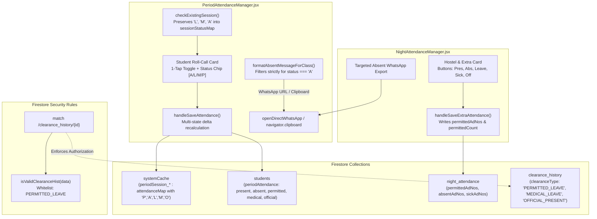

# Design Document: Permitted Leave Attendance & Targeted Absentees Export

* **Author:** safmuzammil
* **Date:** 2026-11-11
* **Status:** APPROVED

---

## 1. Problem Statement

Across Darul Huda Degree Campus, academic faculty and hostel wardens operate multiple attendance-taking portals:
1. **Period Attendance (`PeriodAttendanceManager.jsx`)**: Real-time hourly classroom lecture roll-call across 9 daily periods.
2. **Night Attendance (`NightAttendanceManager.jsx`)**: Night hostel roll-call and congregational Jamath attendance.
3. **Extra Attendance (`NightAttendanceManager.jsx`)**: Special study camps, assemblies, and extra academic sessions.

In daily operations, two systemic deficiencies impede accurate student tracking and faculty communication:

1. **Absence of a First-Class "Permitted Leave" Option**:
   - Currently, roll-call states are constrained to binary choices (`Present` vs `Absent`) or automated gate outpass/medical waivers.
   - When students obtain sanctioned departmental permissions (e.g. library research, academic competition preparation, approved family leave, or sanctioned private study), faculty must either mark them physically `PRESENT` (untrue audit record) or `ABSENT` (unfairly penalizing academic marks and triggering disciplinary absence notices).
   - In [`PeriodAttendanceManager.jsx`](file:///D:/Codes/mark-entry-app/app/components/PeriodAttendanceManager.jsx), the internal state tracks only `absentRegNos`. When an existing session is re-opened, any student not marked `'A'` or `'M'` is automatically loaded as `PRESENT`, completely wiping out any intermediate leave designations upon re-saving.
   - In [`firestore.rules`](file:///D:/Codes/mark-entry-app/firestore.rules#L401), `isValidClearanceHist` strictly validates `clearanceType in ['MEDICAL_LEAVE', 'OFFICIAL_PRESENT']`. Any clearance or audit record attempting to write `PERMITTED_LEAVE` is immediately rejected with permission errors.

2. **WhatsApp and Clipboard Export Over-Inclusion**:
   - When attendance recorders forward roll-call summaries to Class Teachers or faculty groups via WhatsApp or clipboard copy, existing routines frequently include full rosters or mix excused leaves with unexcused absentees.
   - Class Teachers requiring urgent follow-up need a clean, structured notification containing **strictly unexcused absent students** (`status === 'A'`), contextualized with Class, Date, and Period / Session information, with special characters safely URL-encoded.

---

## 2. Overview & Solution Narrative

This design introduces a unified **Permitted Leave (`'L'`)** attendance architecture alongside an export engine for targeted absentee communication:

1. **Standardized Five-State Attendance Taxonomy**:
   - Establishes a unified data contract across session documents and audit logs:
     * `'P'`: Present (Physical attendance)
     * `'A'`: Unexcused Absent (Subject to shortage and mark deduction)
     * `'L'`: Permitted Leave (Sanctioned departmental/campus leave, excused)
     * `'M'`: Medical Leave (Excused bed rest / hospital admission)
     * `'O'`: Official Duty (Authorized institutional representation, counted as present)

2. **Accurate State-Transition & Delta Calculations**:
   - Replaces the binary `absentRegNos` array state in `PeriodAttendanceManager.jsx` with a multi-state mapping `sessionStatusMap: { [regNo]: 'P' | 'A' | 'L' | 'M' | 'O' }`.
   - Modifies session re-opening logic so that existing `'L'` records are accurately preserved and displayed.
   - Fixes delta calculations during session re-saves: transitioning a student from `'A'` to `'L'` correctly decrements absence penalties, prunes the date from `absentDates`, and increments `permittedCount` without inflating physical presence ratios.

3. **Progressive Roll-Call Ergonomics**:
   - Preserves fast 1-tap mobile roll-call. Default card tap continues to toggle between `Present` and `Absent`.
   - On non-present cards, provides an intuitive status chip selector cycling through `[🔴 ABSENT]` ➔ `[🟣 PERMITTED LEAVE]` ➔ `[🟡 MEDICAL]` ➔ `[🟢 PRESENT]`.
   - In Extra Attendance and Night Attendance, includes dedicated `Leave` button options alongside `Pres`, `Abs`, `Sick`, and `Off`.

4. **Targeted Unexcused Absentees WhatsApp & Clipboard Generator**:
   - Implements a standardized export filter strictly isolating students with `status === 'A'`.
   - Formats messages with complete context:
     ```text
     *📋 ABSENTEES REPORT — CLASS [ClassName]*
     📅 Date: [Date] | [Period: N / Session: Extra Study / Night Jamath]
     📖 Subject: [Subject / Activity Name]
     👨‍🏫 Teacher: [TeacherName]

     *Unexcused Absent Students ([Count]):*
     1. [Student Name] (#[AdNo] • Roll: [RollNo])
     ```
   - Automatically URL-encodes payloads for WhatsApp Web/Mobile and disables action buttons when there are zero unexcused absentees.

---

## 3. Goals & Non-Goals

### In-Scope Goals
* **Universal Permitted Leave (`'L'`)**: Implement `'L'` across `PeriodAttendanceManager.jsx`, `NightAttendanceManager.jsx`, and `PeriodAttendanceMinusAndClearance.jsx`.
* **Security Rules Whitelist**: Update `firestore.rules` to allow `clearanceType == 'PERMITTED_LEAVE'` in `isValidClearanceHist`.
* **Session Re-Save Delta Accounting**: Correctly update `students.{id}.periodAttendance` counters when switching statuses on existing session docs.
* **Targeted Absentees Export**: Deliver one-click WhatsApp and Clipboard exports filtered strictly for unexcused absentees (`'A'`).
* **Mobile Speed Preservation**: Retain 1-tap rapid roll-call without touch-target crowding.

### Out-of-Scope Non-Goals
* Altering Continuous and Comprehensive Evaluation (CCE) examination mark formulas.
* Building a pending absence follow-up queue or inbox (explicitly skipped per user decision).
* Modifying barcode security scanning at the campus gate kiosk.

---

## 4. Technical Plan (Architecture & Specifications)

### 4.1 System Topology & Data Flow



---

### 4.2 Module Specifications

#### 1. Security Rules Whitelist (`firestore.rules`)
* Update `isValidClearanceHist` at line 401:
  ```javascript
  function isValidClearanceHist(data) {
    return data.keys().hasAll([
      'id', 'certNumber', 'studentRegNo', 'studentAdNo',
      'studentName', 'clearanceType', 'reason', 'dates',
      'totalPeriodsCleared', 'issuedByUsername', 'issuedAt'
    ]) &&
    ...
    data.clearanceType in ['MEDICAL_LEAVE', 'OFFICIAL_PRESENT', 'PERMITTED_LEAVE'] &&
    ...
  }
  ```

#### 2. Period Attendance Roll-Call & Session Lifecycle (`PeriodAttendanceManager.jsx`)
* **State Upgrade**:
  - Replace `absentRegNos` (`string[]`) with `sessionStatusMap` (`Record<string, 'P' | 'A' | 'L' | 'M' | 'O'>`).
  - Maintain helper `getEffectiveStudentStatus(st)` that computes initial status from Gate Outpasses, recorded medical waivers, or default `P`.
* **Session Loader Integrity**:
  - In `checkExistingSession`:
    ```javascript
    const sMap = {};
    Object.entries(attMap).forEach(([k, val]) => {
      sMap[k] = val; // Preserves 'L', 'M', 'O', 'A', 'P'
    });
    setSessionStatusMap(sMap);
    ```
* **Delta Recalculation on Re-Save**:
  - When re-saving existing sessions, compute full transition diffs for each student:
    * From `'A'` to `'L'`: remove date from `absentDates`, increment `permittedCount` and `subObj.permitted`.
    * From `'P'` to `'L'`: decrement `presentCount`, increment `permittedCount`.
    * From `'L'` to `'P'`: decrement `permittedCount`, increment `presentCount`.
    * From `'L'` to `'A'`: decrement `permittedCount`, add date to `absentDates`.
* **Card UI & Progressive Disclosure**:
  - Tapping card background toggles `P` ↔ `A`.
  - When non-present, clicking the badge chip cycles: `[🔴 ABSENT]` ➔ `[🟣 LEAVE]` ➔ `[🟡 MEDICAL]` ➔ `[🟢 PRESENT]`.

#### 3. Extra & Night Attendance Enhancements (`NightAttendanceManager.jsx`)
* Add `LEAVE` button alongside `Pres`, `Abs`, `Sick`, `Off` in card controls.
* Store `permittedAdNos` and `permittedCount` in `night_extra_attendance` session records.
* In student stats, update `permittedCount` accordingly.

#### 4. Targeted Absentees WhatsApp & Clipboard Generator
* In `PeriodAttendanceManager.jsx`, rewrite `formatAbsentMessageForClass(group)`:
  - Filter `group.students` solely for `status === 'A'`.
  - Exclude any student with status `'P'`, `'M'`, `'O'`, or `'L'`.
  - Contextual header with Class Name, Date, Period number, Subject Alias, and Faculty Name.
  - Numbered list: `N. [Student Name] (#[AdNo] • Roll: [RollNo])`.
  - If 0 absentees: `None (All students present or excused)`.
  - Wrap output with `encodeURIComponent` when launching WhatsApp.

---

## 5. Alternatives Considered

| Alternative Considered | Pros | Cons | Why Rejected |
| :--- | :--- | :--- | :--- |
| **Alternative A: 4-Button Cluster on Every Student Card** | Explicit button for every status visible immediately. | Multiplies interactive elements to 160–240 buttons per roster; causes severe touch-target crowding on mobile screens (360px–420px width); slows down routine 1-tap roll-calls. | Rejected for progressive disclosure: keep 1-tap card toggle for `Present` ↔ `Absent`, with an interactive status badge chip cycling non-present options. |
| **Alternative B: Merging Permitted Leave into Generic `PRESENT`** | Zero schema changes; no need to update session loaders or rules. | Falsifies physical roll-call records; impossible to audit student whereabouts during campus emergencies; inflates physical attendance metrics. | Rejected by institutional requirement: Permitted leaves must be identifiable under `'L'` without being penalized as unexcused absences. |
| **Alternative C: Merging Permitted Leave into Medical Leave (`'M'`)** | Reuses existing `'M'` excusal logic. | Corrupts medical provenance; students on approved academic/family leave appear as infirmary/hospital cases. | Rejected by institution: Medical provenance must remain strictly reserved for sickness, hospital cases, and doctor-prescribed bed rest. |
| **Alternative D: Client-Side Full Attendance WhatsApp Message** | Shows all students regardless of status. | Clutters class teacher WhatsApp notifications with 30–40 names; class teachers cannot quickly identify who is actually missing from class. | Rejected by user requirement: Class teachers need an instant, focused list strictly containing unexcused absentees (`'A'`). |
| **Alternative E: Pending Absence Queue / Inbox** | Collects all pre-recorded absences in a centralized verification queue. | Adds UI clutter and administrative overhead for teachers before submitting hourly period attendance. | Explicitly rejected by user: User requested skipping the pending absence queue. |

---

## 6. Detailed Implementation Plan & Execution Phasing

### Phase 1: Security Rules Deployment (Subagent Delegation)
* **Target File**: [`firestore.rules`](file:///D:/Codes/mark-entry-app/firestore.rules)
* **Execution**: Delegate authoring to the `firestore-rules-author` subagent.
* **Specification**:
  1. In `isValidClearanceHist` (line 401), add `'PERMITTED_LEAVE'` to the allowed `clearanceType` enum:
     ```javascript
     data.clearanceType in ['MEDICAL_LEAVE', 'OFFICIAL_PRESENT', 'PERMITTED_LEAVE']
     ```
  2. Verify rules compilation and deploy via `firebase deploy --only firestore:rules` or schema test.

---

### Phase 2: Period Attendance Roll-Call & Re-Save Delta Accounting
* **Target File**: [`app/components/PeriodAttendanceManager.jsx`](file:///D:/Codes/mark-entry-app/app/components/PeriodAttendanceManager.jsx)
* **Actions**:
  1. **Session Loader Refactor (`checkExistingSession`)**:
     - Replace array-based `setAbsentRegNos` with `setSessionStatusMap`:
       ```javascript
       const sMap = {};
       Object.entries(attMap).forEach(([k, val]) => {
         sMap[String(k).trim()] = val;
       });
       setSessionStatusMap(sMap);
       ```
     - Ensure `'L'`, `'M'`, `'O'`, `'A'`, and `'P'` are preserved when re-opening existing sessions.
  2. **Session Save & Transition Delta Recalculation (`handleSaveAttendance`)**:
     - For each student, compare `oldStatus` with `newStatus`:
       * If `oldStatus === 'A'` and `newStatus === 'L'`:
         - Remove date from `subObj.absentDates`.
         - Increment `curStat.permittedCount` and `subObj.permitted`.
       * If `oldStatus === 'P'` and `newStatus === 'L'`:
         - Decrement `curStat.presentCount` and `subObj.present`.
         - Increment `curStat.permittedCount` and `subObj.permitted`.
       * If `oldStatus === 'L'` and `newStatus === 'P'`:
         - Decrement `curStat.permittedCount` and `subObj.permitted`.
         - Increment `curStat.presentCount` and `subObj.present`.
       * If `oldStatus === 'L'` and `newStatus === 'A'`:
         - Decrement `curStat.permittedCount` and `subObj.permitted`.
         - Add date to `subObj.absentDates`.
     - Update session doc in `systemCache` with `attendanceMap[reg] = status`.
     - Write updated `periodAttendance` stats back to the `students` collection in discrete chunks ($\le 250$ writes).
  3. **Card UI & Progressive Status Selector**:
     - Default card click toggles `P` ↔ `A`.
     - On non-present student cards, add an interactive status badge chip cycling:
       `[🔴 ABSENT]` ➔ `[🟣 LEAVE]` ➔ `[🟡 MEDICAL]` ➔ `[🟢 PRESENT]`.
  4. **Targeted Absentees WhatsApp & Clipboard Export**:
     - Update `formatAbsentMessageForClass(group)`:
       - Filter `group.students` strictly for `status === 'A'`.
       - Exclude students with `'P'`, `'M'`, `'O'`, or `'L'`.
       - Output formatted text:
         ```text
         *📋 ABSENTEES REPORT — CLASS ${group.className}*
         📅 Date: ${attDate} | Period: ${attSession}
         📖 Subject: ${subTitle}
         👨‍🏫 Teacher: ${activeTeacherObj?.fullName || 'Faculty'}

         *Unexcused Absent Students (${unexcusedStudents.length}):*
         ${lines || 'None (All students present or excused)'}
         ```
       - Wrap WhatsApp URL payload in `encodeURIComponent`.
       - Disable the WhatsApp button when `unexcusedStudents.length === 0`.

---

### Phase 3: Extra & Night Attendance Integration
* **Target File**: [`app/components/NightAttendanceManager.jsx`](file:///D:/Codes/mark-entry-app/app/components/NightAttendanceManager.jsx)
* **Actions**:
  1. Add `LEAVE` button (`id: 'LEAVE', label: 'Leave', activeBg: '#8b5cf6'`) in the card action clusters for Extra and Night attendance.
  2. In `handleSaveExtraAttendance`, calculate `permittedAdNos` and `permittedCount`, persisting them to the session doc in `night_attendance` / `night_extra_attendance`.
  3. Update `handleSendExtraToClassTeacher` to strictly filter for unexcused absentees (`status === 'ABSENT'`).

---

### Phase 4: Secondary Clearance Component Sync
* **Target File**: [`app/components/PeriodAttendanceMinusAndClearance.jsx`](file:///D:/Codes/mark-entry-app/app/components/PeriodAttendanceMinusAndClearance.jsx)
* **Actions**:
  1. Ensure `handleApplyClearance` supports setting status to `L` (`PERMITTED_LEAVE`).
  2. When `newStatus === 'L'`, increment `permittedCount`, remove date from `absentDates`, and do not inflate physical presence.

---

### Phase 5: Build Verification & Regression Testing
1. Run `npm run build` with `BypassSandbox: true` to ensure zero JSX, TypeScript, or bundling errors.
2. Verify Firestore security rules evaluation with emulator or test script.
3. Test WhatsApp export string generation with special characters in subject names.
4. Verify session re-edit delta calculations in local state.
