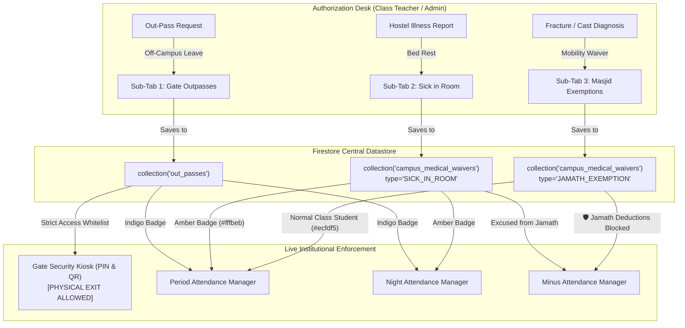

# Design Document: Three-Tiered Unified Leave Architecture & Zero-Friction Attendance Workflows

* **Author:** safmuzammil
* **Date:** 2026-11-10
* **Status:** APPROVED

## 1. Problem Statement

The campus management workflow at Darul Huda Degree Campus faces operational friction across attendance recording and leave tracking:

1. **Roll-Call Latency in Hostel Corridors**: During Night Attendance and Extra Attendance, wardens and teachers verify batches of 35–80 students under tight time windows. Existing UI popups (modals requesting text reasons, end-dates, and timestamps upon marking absence or sick status) interrupt roll-call speed, creating severe administrative bottlenecks.
2. **Ambiguity in Student Absence Categories**: The campus enforces three fundamentally different types of leaves, which are currently conflated or handled ad-hoc:
   * *Physical Gate Outpass*: Leaving campus boundaries (requires security gate clearance).
   * *Hostel Sick in Room*: Staying in the hostel room to rest due to acute illness (excused from academic classes and congregational Jamath, but strictly confined to campus).
   * *Masjid Jamath Exemption*: Physical attendance in academic classrooms, but excused from climbing stairs to the central masjid 5 times daily due to fractures, plaster casts, crutches, or bandages.
3. **Disciplinary Penalties on Injured Students**: Without automated cross-checks, disciplinary monitors entering "Jamath Missing" penalties in Minus Attendance inadvertently deduct marks from students with legitimate leg fractures or medical exemptions.
4. **Perimeter Security Leakage**: If internal hostel sick leaves are mixed with gate outpasses, gate security guards risk letting sick students leave the campus without authorized parent and administrative consent.

## 2. Overview & Solution Narrative

This design elevates the existing `Out-Pass Desk` into a unified **`Leaves & Outpass`** module (`🪪`) containing three dedicated sub-tabs:
* **Sub-Tab 1: 🪪 Gate Outpasses**: External campus exits connected to Gate Security.
* **Sub-Tab 2: 🤒 Sick in Room**: In-hostel medical bed rest authorized by Class Teachers and Admin, auto-syncing to Period Attendance.
* **Sub-Tab 3: 🩹 Masjid Exemptions**: Orthopedic/mobility waivers authorized by Class Teachers and Admin, shielding students in Minus Attendance.

Concurrently, it transforms **Night Attendance** and **Extra Attendance** into modal-free, 1-tap roll-call systems utilizing inline 4-way segmented buttons (`Present`, `Absent`, `Sick`, `Official`), while preserving the critical invariant that night attendance remains strictly isolated to the night report.

## 3. Goals & Non-Goals

### In-Scope Goals
* **Modal-Free Roll-Call Engine**: Implement an inline 4-way tactile segmented selector (`[🟢 Present] [🔴 Absent] [🤒 Sick] [🏛️ Official]`) across Night Attendance and Extra Attendance, eliminating all mandatory modal prompts during roll-call.
* **Night Ledger Isolation**: Guarantee that marking a resident `Sick in Room` at night does not mutate or auto-excuse the next morning's academic periods.
* **Unified Leaves Desk**: Consolidate `Out-Pass Desk` into `Leaves & Outpass` with three focused sub-tabs: Gate Outpasses, Sick in Room, and Masjid Exemptions.
* **Authority Gate**: Restrict creation and revocation of Sick in Room and Masjid Exemptions strictly to assigned Class Teachers and Central Admin.
* **Open-Ended Medical Validity**: Support open-ended active statuses that persist without mandatory calendar deadlines until manually revoked upon recovery.
* **Cross-Tab Synchronization**:
  * Period Attendance automatically badges Category 2 as `🤒 Sick in Room` (Amber `#fffbeb`/`#d97706`).
  * Minus Attendance actively checks Category 3 waivers and blocks or warns against "Jamath Missing" deductions.
* **Gate Security Perimeter Quarantine**: Ensure Gate Security Kiosks display and scan only Category 1 Gate Outpasses, preventing internal sick students from unauthorized campus exit.

### Out-of-Scope Non-Goals
* Automatic morning class absence generation triggered by night roll-call entries.
* Biometric or RFID automated turnstile scanning for masjid attendance.
* Pharmacy medicine inventory and medical diagnosis charting.

---

## 4. Technical Plan & System Architecture

### 4.1 System Topology & Data Flow



### 4.2 Data Model: `campus_medical_waivers` Collection

A dedicated Firestore collection `campus_medical_waivers` is introduced to manage internal campus leaves without overloading physical gate outpasses:

```typescript
interface CampusMedicalWaiver {
  id: string; // waiver_${Date.now()}_${adNo}
  studentRegNo: string;
  adNo: string;
  studentName: string;
  className: string;
  department?: string;
  waiverType: 'SICK_IN_ROOM' | 'JAMATH_EXEMPTION';
  injuryReason: string; // e.g., "Leg Fracture / Plaster Cast", "Acute Viral Fever"
  roomNumber?: string; // e.g. "Room 204, Wing B"
  notes?: string;
  issuedBy: string; // teacher username or admin
  issuedByName: string; // teacher full name
  issuedByRole: 'CLASS_TEACHER' | 'ADMIN';
  issuedAt: string; // ISO-8601 string
  status: 'ACTIVE' | 'REVOKED';
  revokedAt?: string | null;
  revokedBy?: string | null;
  revokedByName?: string | null;
  revocationNotes?: string | null;
}
```

### 4.3 Component Refactoring & Implementation Specifications

#### 1. Navigation Shell (`app/components/TeacherPortalView.jsx`)
* Rename the sidebar entry from `Out-Pass Desk` to `Leaves & Outpass` (`🪪`).
* Keep active view ID as `'outpass'` for 100% backward route compatibility.
* Pass `classTeacherOf={loggedInTeacher?.outpassPrivileges?.classTeacherOf || []}` and `isClassTeacher={Boolean(myClassTeacherOf.length > 0)}` to the embedded outpass view.

#### 2. Unified Leaves Desk (`app/outpass/page.jsx` / `StudentOutpassTab.jsx`)
* Wrap the top level with a persistent 3-segment sub-tab navigator:
  1. `🪪 Gate Outpasses`: Retains existing outpass table, filters, parent verification, gate pass printing, and approval actions.
  2. `🤒 Sick in Room`: Roster of active bed-rest students, quick-filter by class, "Grant Bed Rest" action modal, and "Mark Recovered" button (sets `status = 'REVOKED'`).
  3. `🩹 Masjid Exemptions`: Roster of students with mobility/orthopedic exemptions, "Grant Jamath Exemption" modal with injury presets, and "Revoke Exemption" action.
* **Gate Security Quarantine**: If the viewer is authenticated as `Gate Security` or accessed via the Gate PIN terminal, sub-tabs 2 and 3 are completely hidden.

#### 3. Modal-Free 4-Way Segmented Roll-Call (`app/components/NightAttendanceManager.jsx`)
* Replace single-card popups (`openAbsenceModal`) with an inline 4-way tactile segmented control:
  * `[ 🟢 Present ]`: High-contrast green border/background.
  * `[ 🔴 Absent ]`: High-contrast red border/background.
  * `[ 🤒 Sick ]`: High-contrast amber border/background (`#fffbeb`, `#d97706`).
  * `[ 🏛️ Official ]`: High-contrast cyan/teal border/background (`#f0fdfa`, `#0d9488`).
* If a student has an active `Gate Outpass` (`status === 'OUTSIDE'`), the selector is disabled with an auto-locked Indigo badge: `🪪 Outside Campus`.
* Apply the identical 4-way inline selector to **Extra Attendance** (`viewMode === 'extra_attendance'`).
* **Isolation Rule**: Night attendance saves record directly to `night_attendance/{date}` and do not alter `systemCache/periodSession_*` records.

#### 4. Period Attendance Integration (`app/components/PeriodAttendanceManager.jsx` & `ClassPeriodMonitorTab.jsx`)
* Load active waivers from `campus_medical_waivers` where `status === 'ACTIVE'`.
* Map students with `waiverType === 'SICK_IN_ROOM'` to an Amber card badge: `🤒 Sick in Room`.
* Count them in period attendance summary metrics under the dedicated `🤒 Medical: N` counter.

#### 5. Proactive Minus Attendance Shield (`app/components/MinusAttendanceManager.jsx`)
* Subscribe to active waivers with `waiverType === 'JAMATH_EXEMPTION'`.
* In the deduction entry form, if the selected deduction reason is `Jamath Missing` (or related prayer discipline) and the student has an active `JAMATH_EXEMPTION`:
  * Render an unmistakable warning card: `🛡️ Protected Waiver: Student has an active Masjid Exemption (Reason: [Reason]). Jamath deduction is blocked.`
  * Disable the Submit button by default, with an explicit Admin Override confirmation checkbox.

### 4.4 Conflict Resolution & Status Precedence Matrix

When a student holds multiple overlapping records, the system applies the following strict precedence order:

1. **Precedence 1 (Highest): Gate Outpass (`OUTSIDE`)**: If a student is physically outside campus, they cannot be in class, hostel, or masjid. Status = `🪪 Outside Campus`.
2. **Precedence 2: Sick in Room (`SICK_IN_ROOM`)**: Student is in hostel bed rest. Excused from class periods and masjid Jamath. Status = `🤒 Sick in Room`.
3. **Precedence 3: Masjid Exemption (`JAMATH_EXEMPTION`)**: Student is in class learning normally, but excused from masjid stairs/Jamath. Class status = `🟢 Present`; Jamath status = `🩹 Masjid Exempt`.
4. **Precedence 4: Standard Roll-Call**: Manual entry (`Present` vs `Absent`).

---

## 5. Alternatives Considered

### Alternative 1: Adding a Separate Sidebar Item (`Campus Leaves`) Alongside `Out-Pass Desk`
* **Description**: Create two separate top-level sidebar entries: one for `Out-Pass Desk` (off-campus physical exits) and a second for `Campus Leaves` (internal hostel sick leaves and masjid exemptions).
* **Rationale for Rejection**: *Rejected by author: Navigation Bloat & Workflow Fragmentation*. The faculty portal sidebar already contains 8 core navigation items. Adding another tab clutters the interface and forces teachers to context-switch across multiple tabs when reviewing student absence. Elevating `Out-Pass Desk` to a unified `Leaves & Outpass` desk with three sub-tabs provides a single, cohesive hub for all leave approvals while keeping the navigation menu clean.

### Alternative 2: Modal Popups for Recording Reasons During Night & Extra Roll-Call
* **Description**: Continue prompting wardens and teachers with a modal dialog upon tapping `Sick` or `Absent` to capture the medical ailment, expected duration, and parent communication notes.
* **Rationale for Rejection**: *Rejected by author: Operational Latency in Hostel Corridors*. Hostel roll-calls and extra sessions require taking attendance across 35–80 residents in under 2 minutes. Dialog modals interrupt roll-call rhythm and introduce intolerable latency. Detailed medical metadata is captured upstream during formal waiver issuance in the `Leaves & Outpass Desk`; roll-call taking must remain strictly a 1-tap operation.

### Alternative 3: Automatic Spillover of Night Attendance "Sick" Marks into Morning Period Attendance
* **Description**: If a student is marked `Sick in Room` during 10:00 PM Night Attendance, the system automatically registers them as `Sick in Room` for next morning's Period 1 (7:45 AM).
* **Rationale for Rejection**: *Rejected by author: Accountability & Exam Integrity Hazard*. Evening complaints (e.g., mild headache) do not always warrant missing morning classes or scheduled class tests. Automatically carrying night marks into morning academic periods creates an accountability loophole where students bypass morning classes without formal Class Teacher verification. Night attendance remains strictly isolated to the night hostel report.

### Alternative 4: Storing Internal Waivers in the Existing `out_passes` Firestore Collection
* **Description**: Store Category 2 and Category 3 leaves in `collection('out_passes')` with a special flag `isInternalWaiver: true`.
* **Rationale for Rejection**: *Rejected by author: Perimeter Security Quarantine Violation*. Gate Security Kiosks and barcode scanners query `out_passes` to validate exits at the campus gate. Merging internal sick leaves into the outpass collection introduces query-filtering risks where a bug or missing filter could display internal bed-rest students on the gate exit whitelist, allowing unapproved campus exits. Maintaining a distinct `campus_medical_waivers` collection completely isolates perimeter security from internal medical bed rest.

---

## 6. Detailed Implementation Plan

This section provides an actionable, file-by-file specification covering all code, component, and schema modifications required to implement the Three-Tiered Leave Architecture and Modal-Free Roll-Call Engine.

### 6.1 Affected Codebase Files

| File Path | Nature of Change | Core Responsibility / Rationale |
| :--- | :--- | :--- |
| [`app/components/TeacherPortalView.jsx`](file:///D:/Codes/mark-entry-app/app/components/TeacherPortalView.jsx) | **Modify** | Update navigation label from `Out-Pass Desk` to `Leaves & Outpass` (`🪪`). Pass class teacher scope and outpass privileges to child components. |
| [`app/outpass/page.jsx`](file:///D:/Codes/mark-entry-app/app/outpass/page.jsx) | **Modify** | Add 3-way top sub-tab bar (`Gate Outpasses`, `Sick in Room`, `Masjid Exemptions`). Quarantine gate security view so internal waivers are never shown at the gate. |
| [`app/outpass/components/SickInRoomSubTab.jsx`](file:///D:/Codes/mark-entry-app/app/outpass/components/SickInRoomSubTab.jsx) | **Create** | Dedicated sub-tab for managing Category 2 hostel bed-rest leaves with grant modal, active roster, and one-click recovery revocation. |
| [`app/outpass/components/MasjidExemptionSubTab.jsx`](file:///D:/Codes/mark-entry-app/app/outpass/components/MasjidExemptionSubTab.jsx) | **Create** | Dedicated sub-tab for managing Category 3 orthopedic/fracture prayer exemptions with injury presets and revocation controls. |
| [`app/components/NightAttendanceManager.jsx`](file:///D:/Codes/mark-entry-app/app/components/NightAttendanceManager.jsx) | **Modify** | Replace modal dialog interruptions in both Night Attendance and Extra Attendance with inline 4-way tactile segmented buttons (`Present`, `Absent`, `Sick`, `Official`). Enforce night isolation invariant. |
| [`app/components/PeriodAttendanceManager.jsx`](file:///D:/Codes/mark-entry-app/app/components/PeriodAttendanceManager.jsx) | **Modify** | Cross-check active `SICK_IN_ROOM` waivers from `campus_medical_waivers` and render them in warm Amber with dedicated `🤒 Medical: N` counter. |
| [`app/components/ClassPeriodMonitorTab.jsx`](file:///D:/Codes/mark-entry-app/app/components/ClassPeriodMonitorTab.jsx) | **Modify** | Display active `SICK_IN_ROOM` students in the live period monitor metrics and excused leaves summary in warm Amber. |
| [`app/components/MinusAttendanceManager.jsx`](file:///D:/Codes/mark-entry-app/app/components/MinusAttendanceManager.jsx) | **Modify** | Cross-check active `JAMATH_EXEMPTION` waivers and display a protective banner blocking `Jamath Missing` deductions for injured students. |

---

### 6.2 Detailed Step-by-Step Execution Sequence

#### Step 1: Firestore Collection Provisioning & Types
* Define collection `campus_medical_waivers`.
* Create helper functions for creating waivers, listing active waivers, and revoking waivers.
* Implement indexing on `status` (`ACTIVE` / `REVOKED`) and `className` for compound queries.

#### Step 2: Implement Internal Leaves Sub-Tabs
* Create [`app/outpass/components/SickInRoomSubTab.jsx`](file:///D:/Codes/mark-entry-app/app/outpass/components/SickInRoomSubTab.jsx):
  * **Header KPI Cards**: Total Active Sick, By Class breakdown.
  * **Authorization Guard**: Class Teachers can only select and grant leave for students belonging to their assigned class (`classTeacherOf`). Admins can grant for all classes.
  * **Grant Bed Rest Modal**:
    * Student selection dropdown (searchable).
    * Illness reason presets (`Acute Fever / Viral`, `Severe Stomach Flu`, `Asthma / Respiratory Rest`, `Post-Medical Clinic Rest`, `Other`).
    * Hostel room number field.
    * Notes textarea.
  * **Active Roster Table**:
    * Student Name, Ad.No, Class, Illness Reason, Hostel Room Number, Issued Date, Issued By.
    * Action button: `✓ Mark Recovered & Revoke` (updates status to `'REVOKED'`, recording `revokedAt` and `revokedBy`).
* Create [`app/outpass/components/MasjidExemptionSubTab.jsx`](file:///D:/Codes/mark-entry-app/app/outpass/components/MasjidExemptionSubTab.jsx):
  * **Header KPI Cards**: Active Exemptions Count, Classroom Normal Present guarantee notice.
  * **Authorization Guard**: Restricted to Class Teachers and Admin.
  * **Grant Exemption Modal**:
    * Student selection dropdown.
    * Injury reason presets (`Leg Fracture / Plaster Cast`, `Bandage / Open Surgical Dressing`, `Crutches / Severe Ankle Sprain`, `Arm / Shoulder Immobilization`, `Temporary Mobility Impairment`).
    * Notes textarea.
  * **Active Roster Table**:
    * Student Name, Ad.No, Class, Injury Details, Issued Date, Issued By.
    * Action button: `✓ Mark Healed & Revoke`.

#### Step 3: Integrate Sub-Tabs into `app/outpass/page.jsx`
* Add state `activeLeaveSubTab` (`'outpass'` | `'sick_room'` | `'masjid_exempt'`).
* Render top segmented tab bar:
  * `🪪 Gate Outpasses`: Displays existing outpass tables, filters, and action tools.
  * `🤒 Sick in Room`: Renders `SickInRoomSubTab`.
  * `🩹 Masjid Exemptions`: Renders `MasjidExemptionSubTab`.
* **Gate Security Quarantine**: If `isGateSecurityMode === true` or accessing via Gate PIN, lock sub-tab to `'outpass'` and suppress the sub-tab bar completely.

#### Step 4: Navigation Shell Update in `app/components/TeacherPortalView.jsx`
* Update `teacherNavItems` entry:
  * `label: 'Leaves & Outpass'`
  * `icon: '🪪'`
* Pass `classTeacherOf` and `isClassTeacher` props into the child outpass component.

#### Step 5: Modal-Free 4-Way Segmented Roll-Call in `app/components/NightAttendanceManager.jsx`
* Replace `onClick={() => setAbsenceModalStudent(st)}` and dialog modal triggers with an inline segmented button container on each student card:
  * Button 1 (`Present`): Sets `statusMap[ad] = 'PRESENT'`.
  * Button 2 (`Absent`): Sets `statusMap[ad] = 'ABSENT'`.
  * Button 3 (`Sick`): Sets `statusMap[ad] = 'SICK'`.
  * Button 4 (`Official`): Sets `statusMap[ad] = 'OFFICIAL'`.
* Auto-disabled locked state: If `activePass?.status === 'OUTSIDE'`, display locked badge `🪪 Outside Campus` without clickable buttons.
* Apply the identical 4-way inline selector in **Extra Attendance** (`viewMode === 'extra_attendance'`).
* Verify that saving night attendance writes exclusively to `night_attendance/{date}` and does not alter period attendance caches.

#### Step 6: Period Attendance & Monitor Auto-Badging
* In [`PeriodAttendanceManager.jsx`](file:///D:/Codes/mark-entry-app/app/components/PeriodAttendanceManager.jsx) and [`ClassPeriodMonitorTab.jsx`](file:///D:/Codes/mark-entry-app/app/components/ClassPeriodMonitorTab.jsx):
  * Query `campus_medical_waivers` where `status === 'ACTIVE'`.
  * Build lookup map: `activeWaiversByReg`.
  * If student has active `SICK_IN_ROOM` waiver:
    * Render Amber card styling `#fffbeb` with border `#fde68a`.
    * Display badge: `🤒 SICK IN ROOM (Hostel Bed Rest)`.
    * Count in `periodMedCount` / `medicalCount`.

#### Step 7: Minus Attendance Proactive Jamath Protection
* In [`MinusAttendanceManager.jsx`](file:///D:/Codes/mark-entry-app/app/components/MinusAttendanceManager.jsx):
  * Query `campus_medical_waivers` where `waiverType === 'JAMATH_EXEMPTION' && status === 'ACTIVE'`.
  * Build lookup map: `jamathExemptionsByAdNo`.
  * In the single student deduction form, when `studentAdNo` is entered and `reason` contains `Jamath` or `Masjid`:
    * If `jamathExemptionsByAdNo[cleanAd]` exists:
      * Render high-priority warning card: `🛡️ Protected: [Student Name] has an active Masjid Exemption (Reason: [Reason]). Jamath deduction is blocked.`
      * Disable the Submit button unless the user checks `[x] Admin Force Override`.
