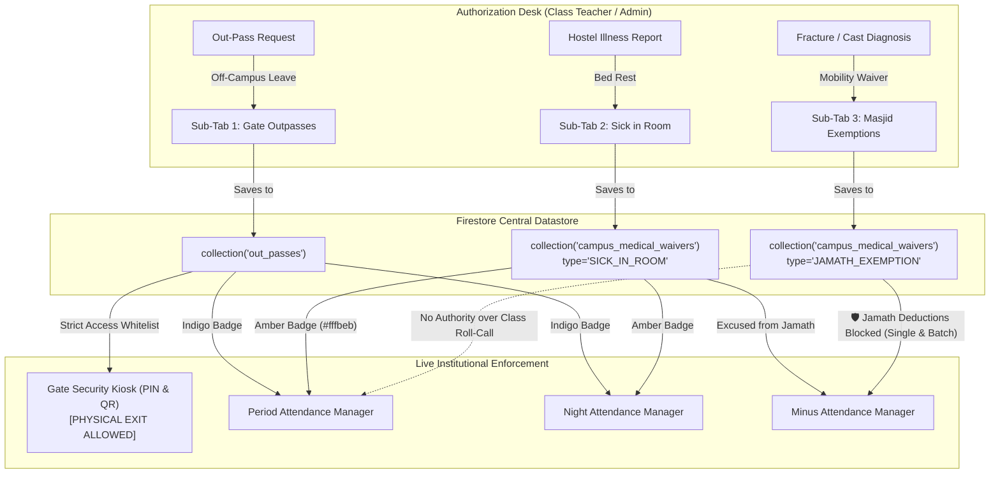

# Design Document: Three-Tiered Unified Leave Architecture & Zero-Friction Attendance Workflows

* **Author:** safmuzammil
* **Date:** 2026-11-10
* **Status:** APPROVED & REMEDIATED

## 1. Problem Statement

The campus management workflow at Darul Huda Degree Campus faces operational friction across attendance recording and leave tracking:

1. **Roll-Call Latency in Hostel Corridors**: During Night Attendance and Extra Attendance, wardens and teachers verify batches of 35–80 students under tight time windows. Existing UI popups (modals requesting text reasons, end-dates, and timestamps upon marking absence or sick status) interrupt roll-call speed, creating severe administrative bottlenecks.
2. **Ambiguity in Student Absence Categories**: The campus enforces three fundamentally different types of leaves, which are currently conflated or handled ad-hoc:
   * *Physical Gate Outpass*: Leaving campus boundaries (requires security gate clearance).
   * *Hostel Sick in Room*: Staying in the hostel room to rest due to acute illness (excused from academic classes and congregational Jamath, but strictly confined to campus).
   * *Masjid Jamath Exemption*: Physical attendance in academic classrooms, but excused from climbing stairs to the central masjid 5 times daily due to fractures, plaster casts, crutches, or bandages.
3. **Disciplinary Penalties on Injured Students**: Without automated cross-checks, disciplinary monitors entering "Jamath Missing" penalties in Minus Attendance inadvertently deduct marks from students with legitimate leg fractures or medical exemptions.
4. **Perimeter Security Leakage**: If internal hostel sick leaves are mixed with gate outpasses, gate security guards risk letting sick students leave the campus without authorized parent and administrative consent.

## 2. Overview & Solution Narrative

This design elevates the existing `Out-Pass Desk` into a unified **`Leaves & Outpass`** module (`🪪`) containing three dedicated sub-tabs:
* **Sub-Tab 1: 🪪 Gate Outpasses**: External campus exits connected to Gate Security.
* **Sub-Tab 2: 🤒 Sick in Room**: In-hostel medical bed rest authorized by Class Teachers and Admin, auto-syncing to Period Attendance, with an overnight handshake queue bridging evening hostel roll-call to morning classroom sessions.
* **Sub-Tab 3: 🩹 Masjid Exemptions**: Orthopedic/mobility waivers authorized by Class Teachers and Admin, shielding students in Minus Attendance against Jamath deductions.

Concurrently, it transforms **Night Attendance** and **Extra Attendance** into modal-free, 1-tap roll-call systems utilizing responsive inline 4-way segmented buttons (`Present`, `Absent`, `Sick`, `Official`), while preserving the critical invariant that night attendance remains strictly isolated to the night report.

## 3. Goals & Non-Goals

### In-Scope Goals
* **Modal-Free Roll-Call Engine**: Implement an inline 4-way tactile segmented selector (`[🟢 Present] [🔴 Absent] [🤒 Sick] [🏛️ Official]`) across Night Attendance and Extra Attendance, with a 2x2 grid layout on mobile screens, eliminating all mandatory modal prompts during roll-call.
* **Night Ledger Isolation & Handshake Queue**: Guarantee that marking a resident `Sick in Room` at night does not directly mutate academic periods, while feeding a morning "Handshake Queue" where the assigned Class Teacher can grant a formal bed-rest waiver with one click.
* **Unified Leaves Desk**: Consolidate `Out-Pass Desk` into `Leaves & Outpass` with three focused sub-tabs: Gate Outpasses, Sick in Room, and Masjid Exemptions.
* **Authority Gate**: Restrict creation and revocation of Sick in Room and Masjid Exemptions strictly to assigned Class Teachers and Central Admin.
* **Open-Ended Medical Validity**: Support open-ended active statuses that persist without mandatory calendar deadlines until manually revoked upon recovery.
* **Cross-Tab Synchronization**:
  * Period Attendance automatically badges Category 2 as `🤒 Sick in Room` (Amber `#fffbeb`/`#d97706`).
  * Minus Attendance actively checks Category 3 waivers across both single and batch entries, blocking "Jamath Missing" deductions.
* **Decoupled Masjid Exemption Precedence**: Ensure Category 3 waivers excuse students from central masjid prayer stairs without forcing classroom presence if the student is absent from class.
* **Gate Security Perimeter Quarantine**: Ensure Gate Security Kiosks display and scan only Category 1 Gate Outpasses, preventing internal sick students from unauthorized campus exit.

### Out-of-Scope Non-Goals
* Automatic morning class absence generation triggered by night roll-call entries.
* Biometric or RFID automated turnstile scanning for masjid attendance.
* Pharmacy medicine inventory and medical diagnosis charting.

---

## 4. Technical Plan & System Architecture

### 4.1 System Topology & Data Flow



### 4.2 Data Model: `campus_medical_waivers` Collection & Token Mapping

#### Firestore Collection Schema:
```typescript
interface CampusMedicalWaiver {
  id: string; // waiver_${Date.now()}_${adNo}
  studentRegNo: string;
  adNo: string;
  studentName: string;
  className: string;
  department?: string;
  waiverType: 'SICK_IN_ROOM' | 'JAMATH_EXEMPTION';
  injuryReason: string; // e.g., "Leg Fracture / Plaster Cast", "Acute Viral Fever"
  roomNumber?: string; // e.g. "Room 204, Wing B"
  notes?: string;
  issuedBy: string; // teacher username or admin
  issuedByName: string; // teacher full name
  issuedByRole: 'CLASS_TEACHER' | 'ADMIN';
  issuedAt: string; // ISO-8601 string
  status: 'ACTIVE' | 'REVOKED';
  revokedAt?: string | null;
  revokedBy?: string | null;
  revokedByName?: string | null;
  revocationNotes?: string | null;
}
```

#### State Token Normalization:
* **Night Attendance Status Map**: `statusMap[ad] = 'SICK_ROOM'` (preserves compatibility with existing reports and monthly aggregates).
* **Firestore Waiver Documents**: `waiverType = 'SICK_IN_ROOM'` in `campus_medical_waivers`.
* **Period Attendance Map**: Maps `SICK_IN_ROOM` waivers to `status = 'SICK_ROOM'`.

### 4.3 Component Refactoring & Implementation Specifications

#### 1. Navigation Shell (`app/components/TeacherPortalView.jsx`)
* Update navigation item label:
  `label: loggedInTeacher?.outpassPrivileges?.isOfficeSecretary ? 'Office Leaves & Outpass' : 'Leaves & Outpass'` (`🪪`).
* Keep active view ID as `'outpass'` for 100% backward route compatibility.
* Pass `classTeacherOf={loggedInTeacher?.outpassPrivileges?.classTeacherOf || []}` and `isClassTeacher={Boolean(myClassTeacherOf.length > 0)}` to child components.

#### 2. Unified Leaves Desk (`app/outpass/page.jsx`)
* Wrap the top level with a persistent 3-segment sub-tab navigator:
  1. `🪪 Gate Outpasses`: Retains existing outpass table, filters, parent verification, gate pass printing, and approval actions.
  2. `🤒 Sick in Room`: Renders `SickInRoomSubTab.jsx` with active bed-rest students and the Morning Handshake Queue.
  3. `🩹 Masjid Exemptions`: Renders `MasjidExemptionSubTab.jsx` with orthopedic exemptions.
* **Gate Security Quarantine**: If `isSecurityKiosk === true`, lock sub-tab to `'outpass'` and completely unmount the sub-tab bar.

#### 3. Modal-Free 4-Way Segmented Roll-Call (`app/components/NightAttendanceManager.jsx`)
* Replace single-card popups with an inline tactile segmented control:
  * `[ 🟢 Present ]`: High-contrast green border/background.
  * `[ 🔴 Absent ]`: High-contrast red border/background.
  * `[ 🤒 Sick ]`: Sets `statusMap[ad] = 'SICK_ROOM'`. High-contrast amber border/background (`#fffbeb`, `#d97706`).
  * `[ 🏛️ Official ]`: Sets `statusMap[ad] = 'OFFICIAL'`. High-contrast cyan/teal border/background (`#f0fdfa`, `#0d9488`).
* **Responsive Ergonomics**: On cards narrower than 320px, render as a 2x2 grid (`[Present] [Absent]` / `[Sick] [Official]`) with minimum touch height of 42px.
* Auto-disabled locked state: If `activePass?.status === 'OUTSIDE'`, display locked badge `🪪 Outside Campus`.
* Apply the identical 4-way inline selector in **Extra Attendance** (`viewMode === 'extra_attendance'`).
* **Isolation Rule**: Night attendance saves record directly to `night_attendance/{date}` and do not alter `systemCache/periodSession_*` records.

#### 4. Period Attendance Integration (`app/components/PeriodAttendanceManager.jsx` & `ClassPeriodMonitorTab.jsx`)
* Load active waivers from `campus_medical_waivers` where `status === 'ACTIVE'` with explicit `useEffect` unsubscription cleanup.
* Map students with `waiverType === 'SICK_IN_ROOM'` to an Amber card badge: `🤒 Sick in Room`.
* Count them in period attendance summary metrics under the dedicated `🤒 Medical: N` counter.

#### 5. Proactive Minus Attendance Jamath Shield (`app/components/MinusAttendanceManager.jsx`)
* Query active waivers with `waiverType === 'JAMATH_EXEMPTION' && status === 'ACTIVE'`.
* In both the **single-student entry form** AND the **comma-separated batch entry (`handleAddCommaSeparatedStudents`)**:
  * If the deduction reason is `Jamath Missing` (or related prayer discipline) and an entered student has an active `JAMATH_EXEMPTION`:
  * Automatically exclude the student from the deduction batch and display a shield alert banner: `🛡️ Protected: [Student Name] (#AdNo) has an active Masjid Exemption (Reason: [Reason]). Jamath deduction is blocked.`
  * Provide an Admin Force Override checkbox allowing administrators to bypass exclusion if explicitly confirmed.

### 4.4 Conflict Resolution & Precedence Matrix

| State Combination | Gate Kiosk Result | Period Attendance Result | Jamath / Minus Result | Night Roll-Call Result |
| :--- | :--- | :--- | :--- | :--- |
| **Active Gate Outpass (`OUTSIDE`)** | ✅ Exit Verified | `🪪 Outside Campus` (Indigo) | Exempt from Jamath | `🪪 Outside Campus` (Locked) |
| **Active Sick in Room (`SICK_IN_ROOM`)** | ❌ Exit Blocked | `🤒 Sick in Room` (Amber) | Exempt from Jamath | `🤒 In Room (Sick)` (Amber) |
| **Active Masjid Exemption (`JAMATH_EXEMPTION`)** | ❌ Exit Blocked | `🟢 Class Roll-Call` (Independent) | 🛡️ **Deductions Blocked** | `🟢 Present in Hostel` (Green) |
| **Standard Roll-Call (No Waivers)** | ❌ Exit Blocked | `Present` or `Absent` | Subject to Jamath Rules | `Present`, `Absent`, or `Sick` |

---

## 5. Alternatives Considered

### Alternative 1: Adding a Separate Sidebar Item (`Campus Leaves`) Alongside `Out-Pass Desk`
* *Rejected by author: Navigation Bloat & Workflow Fragmentation*. Consolidating into a unified `Leaves & Outpass` desk with three sub-tabs provides a single, cohesive hub for all leave approvals while keeping the navigation menu clean.

### Alternative 2: Modal Popups for Recording Reasons During Night & Extra Roll-Call
* *Rejected by author: Operational Latency in Hostel Corridors*. Dialog modals interrupt roll-call rhythm and introduce intolerable latency. Detailed medical metadata is captured upstream during formal waiver issuance in the `Leaves & Outpass Desk`; roll-call taking must remain strictly a 1-tap operation.

### Alternative 3: Automatic Spillover of Night Attendance "Sick" Marks into Morning Period Attendance
* *Rejected by author: Accountability & Exam Integrity Hazard*. Automatically carrying night marks into morning academic periods creates an accountability loophole. Night attendance remains strictly isolated to the night hostel report, with the morning handshake queue providing a controlled confirmation path.

### Alternative 4: Storing Internal Waivers in the Existing `out_passes` Firestore Collection
* *Rejected by author: Perimeter Security Quarantine Violation*. Maintaining a distinct `campus_medical_waivers` collection completely isolates perimeter security from internal medical bed rest.

---

## 6. Detailed Implementation Plan

### 6.1 Affected Codebase Files

| File Path | Nature of Change | Core Responsibility / Rationale |
| :--- | :--- | :--- |
| [`app/components/TeacherPortalView.jsx`](file:///D:/Codes/mark-entry-app/app/components/TeacherPortalView.jsx) | **Modify** | Update navigation label to `Office Leaves & Outpass` / `Leaves & Outpass` (`🪪`). Pass class teacher scope to child components. |
| [`app/outpass/page.jsx`](file:///D:/Codes/mark-entry-app/app/outpass/page.jsx) | **Modify** | Add 3-way top sub-tab bar (`Gate Outpasses`, `Sick in Room`, `Masjid Exemptions`). Quarantine gate security view via `isSecurityKiosk === true`. |
| [`app/outpass/components/SickInRoomSubTab.jsx`](file:///D:/Codes/mark-entry-app/app/outpass/components/SickInRoomSubTab.jsx) | **Create** | Dedicated sub-tab for managing Category 2 hostel bed-rest leaves with grant modal, active roster, morning handshake queue, and recovery revocation. |
| [`app/outpass/components/MasjidExemptionSubTab.jsx`](file:///D:/Codes/mark-entry-app/app/outpass/components/MasjidExemptionSubTab.jsx) | **Create** | Dedicated sub-tab for managing Category 3 orthopedic/fracture prayer exemptions with injury presets and revocation controls. |
| [`app/components/NightAttendanceManager.jsx`](file:///D:/Codes/mark-entry-app/app/components/NightAttendanceManager.jsx) | **Modify** | Replace modal dialog interruptions in both Night Attendance and Extra Attendance with responsive 2x2 inline tactile segmented buttons (`Present`, `Absent`, `SICK_ROOM`, `Official`). Enforce night isolation invariant. |
| [`app/components/PeriodAttendanceManager.jsx`](file:///D:/Codes/mark-entry-app/app/components/PeriodAttendanceManager.jsx) | **Modify** | Cross-check active `SICK_IN_ROOM` waivers from `campus_medical_waivers`, render them in warm Amber with dedicated `🤒 Medical: N` counter, and clean up listeners on unmount. |
| [`app/components/ClassPeriodMonitorTab.jsx`](file:///D:/Codes/mark-entry-app/app/components/ClassPeriodMonitorTab.jsx) | **Modify** | Display active `SICK_IN_ROOM` students in the live period monitor metrics and excused leaves summary in warm Amber. |
| [`app/components/MinusAttendanceManager.jsx`](file:///D:/Codes/mark-entry-app/app/components/MinusAttendanceManager.jsx) | **Modify** | Cross-check active `JAMATH_EXEMPTION` waivers across single and batch entries, displaying a protective banner blocking `Jamath Missing` deductions for injured students. |

---

### 6.2 Step-by-Step Execution Sequence

#### Step 1: Firestore Collection Provisioning & Types
* Define collection `campus_medical_waivers`.
* Define Firestore security rule block:
  ```javascript
  match /campus_medical_waivers/{waiverId} {
    allow read: if request.auth != null;
    allow write: if request.auth != null && (
      request.auth.token.role == 'admin' ||
      (request.auth.token.role == 'teacher' && resource.data.className in request.auth.token.classTeacherOf)
    );
  }
  ```

#### Step 2: Implement `SickInRoomSubTab.jsx` & `MasjidExemptionSubTab.jsx`
* Common Sub-Tab Props:
  ```typescript
  interface SubTabProps {
    students: Student[];
    teachers: Teacher[];
    loggedInUser: Teacher | AdminUser;
    isAdmin: boolean;
    classTeacherOf: string[];
    onWaiverCreated?: () => void;
  }
  ```
* In `SickInRoomSubTab.jsx`:
  * Morning Handshake Queue: Queries recent night attendance sessions for students marked `SICK_ROOM` who do not yet have a formal waiver in `campus_medical_waivers`. Displays a prominent quick-action card allowing Class Teachers to click `[Grant Formal Bed-Rest Waiver]` in one click.
  * Active bed-rest table with `✓ Mark Recovered & Revoke` action.
* In `MasjidExemptionSubTab.jsx`:
  * Active orthopedic/mobility table with injury presets and `✓ Mark Healed & Revoke` action.

#### Step 3: Integrate Sub-Tabs into `app/outpass/page.jsx`
* Add `activeLeaveSubTab` (`'outpass'` | `'sick_room'` | `'masjid_exempt'`).
* When `isSecurityKiosk === true`, force `activeLeaveSubTab = 'outpass'` and completely hide the sub-tab bar.

#### Step 4: Navigation Shell Update in `app/components/TeacherPortalView.jsx`
* Set label: `loggedInTeacher?.outpassPrivileges?.isOfficeSecretary ? 'Office Leaves & Outpass' : 'Leaves & Outpass'`.
* Pass `classTeacherOf` and `isClassTeacher` props.

#### Step 5: Modal-Free Roll-Call in `app/components/NightAttendanceManager.jsx`
* Replace card click modal triggers with responsive 2x2 inline buttons:
  `[ 🟢 Present ] [ 🔴 Absent ]`
  `[ 🤒 Sick ]    [ 🏛️ Official ]`
* Use token `'SICK_ROOM'` for the sick state.
* Apply identical 4-way selector in Extra Attendance.

#### Step 6: Period Attendance & Monitor Auto-Badging
* Subscribe to `campus_medical_waivers` where `status === 'ACTIVE'`, storing the unsubscribe cleanup function.
* Badge `SICK_IN_ROOM` students in Amber `#fffbeb` / `#d97706`.

#### Step 7: Minus Attendance Single & Batch Jamath Protection
* In `MinusAttendanceManager.jsx`, intercept both single entry and `handleAddCommaSeparatedStudents`.
* If deduction reason is `Jamath Missing` and an entered student has an active `JAMATH_EXEMPTION`, exclude them from deduction and display a protective warning alert.
